  Mini Contract.Pro (Free Open Source Electronic Contract)
  ===============


Current Latest Version: v3.2.1 (Release Date: January 27, 2026)

[](https://gitee.com/leepm/mini-contract/blob/master/LICENSE)[](https://gitee.com/leepm/mini-contract)[](https://gitee.com/leepm/mini-contract)[](https://gitee.com/leepm/mini-contract)[](https://gitee.com/leepm/mini-contract)[](https://github.freeleepm/mini-contract)[](https://github.freeleepm/mini-contract)


<h3 align="center">Mini Contract.Pro</h3>


🔥🔥🔥  As a free open-source product with independent intellectual property rights, Mini Contract Pro has always adhered to the principle of "making digital contract development simpler". Mini Contract.Pro is also an open-source electronic signature solution designed specifically for developers, innovatively adopting a "dual-mode engine" architecture. Through modular design, it meets the full-scenario requirements from judicial-level signing to lightweight collaboration. The first open-source electronic signature platform to support both evidence chain and non-evidence chain dual modes, we have helped 100+ enterprise customers achieve digital transformation of contract signing processes.


####  Dual-Mode Engine (Flexibly Address Business Scenarios)

**Judicial-Level Evidence Chain Mode**

Based on the Ant Judicial Chain blockchain evidence storage system, it generates an evidence storage report including timestamps and digital fingerprints for each contract, ensuring contracts comply with the requirements of the "Electronic Signature Law". This mode has been certified by the National Industrial Information Security Development Research Center and is particularly suitable for high-value scenarios such as financial lending, human resources contracts, and intellectual property agreements, with evidence query response speeds reaching millisecond level.


**Lightweight Non-Evidence Chain Mode**

Built on fully self-developed distributed storage architecture and digital signature technology, integrating self-signed CA certificate system for end-to-end encryption and tamper-proof protection. Through intelligent routing algorithms and layered caching strategies, interface call costs are reduced by 60% while response speed increased by 3x. The system features comprehensive audit logs and operation traceability mechanisms, automatically recording key nodes throughout the contract lifecycle including creation, modification, and signing, ensuring every operation is traceable and auditable. Developers can implement full lifecycle contract management without connecting to third-party evidence storage institutions. It is particularly suitable for high-frequency scenarios such as internal approvals, supplier reconciliations, and quick signing, with a capacity to handle tens of millions of signing requests per day. An ideal choice for enterprises seeking high cost-effectiveness.


#### Developer-Friendly

**Plug-and-Play Toolkit**

* Electronic signature/seal cloud hosting service

* Multi-party contract collaborative editing (supports 50+ signing parties operating in parallel)

* Intelligent riding seal generation engine (pixel-level positioning accuracy)

* Full-channel signing pages (Web/H5/Mini Program/APP multi-platform adaptive)


**Deep Open Capabilities**

* Provides SDKs in multiple languages including Java/Python/Go

* Opens rich API interfaces


### Why Choose Mini Contract Pro?

**All-in-One Integration Solution**
We integrate mainstream electronic contract service providers in the market (including but not limited to Fadada, e-SignBao, Junziqian, etc.), providing standardized API integration solutions. Developers don't need to integrate with different vendors individually; they can quickly access multiple services through a unified interface, saving more than 90% of integration time. The pre-configured vendor qualification certification system can help you quickly pass compliance audits.


**Cost Optimization Advantage**
Through the scale effect of centralized procurement, we provide developers with more favorable interface prices than official channels (average discount of 15%-30%). Supports vendor combination selection on demand, avoiding single vendor lock-in risks, truly achieving controllable costs.


**Enterprise-Level Technical Architecture**
Built on Vue3 + TypeScript + Pinia, adopting:

- Modular design: Supports on-demand loading of service provider functions
- Responsive layout: Perfectly adapts to PC/mobile dual platforms
- Configuration-based development: 90% of common requirements can be implemented through configuration
- Complete type support: Comprehensive TS type definitions and interface documentation


**Rapid Implementation Capability (Providing Out-of-the-Box Solution)**

- Standardized UI component library: Contains 30+ business-validated contract template components (MIT license for commercial use)
- Full-link monitoring: Full-process tracking and evidence storage from contract creation to archiving


### Commercial Licensing

1. The commercial version is identical to the open-source version in code, with no distinction;
2. Commercial licensing is perpetual, supporting permanent upgrades;
3. Commercial use requires authorization, and you can contact the technical team below for the authorization method.


### Open Source Notice

1. Only allowed for personal learning and research use;
2. Prohibited from selling this open-source code and resources in any form or name.


### Core Business Scenarios

Mini Contract.Pro has served **100+ enterprise clients**, covering multiple industries and scenarios. Here are typical application scenarios:

#### 🏢 Human Resources & Recruitment

**Business Pain Points**
- High volume of employment contracts, labor agreements, and NDAs
- High cost and long cycle for printing and mailing paper contracts
- Inconvenient for remote employees to sign, affecting onboarding efficiency
- Difficult contract archiving and retrieval

**Solutions**
- ✅ **Batch Initiation**: Support batch upload of employee information, one-click signing initiation
- ✅ **Template Management**: Pre-built templates for labor contracts, NDAs, etc.
- ✅ **Mobile Signing**: Employees can complete signing on mobile, no need to be present
- ✅ **Auto Archiving**: Automatically archive after signing, support search by department and date
- ✅ **Expiry Reminder**: Automatic reminder to HR before contract expiration

**Case Study**: A tech company signs 500+ onboarding contracts monthly, efficiency increased by 80%

---

#### 💰 Finance & Credit

**Business Pain Points**
- Loan agreements and guarantee contracts involve large amounts with high risk
- Require strict legal validity and evidence chain
- Customers distributed widely, high offline signing cost
- Long contract review process affects loan disbursement speed

**Solutions**
- ✅ **Judicial Evidence**: Blockchain evidence storage based on Ant Judicial Chain, ensuring legal validity
- ✅ **Multi-layer Verification**: Face recognition + SMS verification + intent signing, triple protection
- ✅ **Approval Workflow**: Support multi-level approval, ensure compliance
- ✅ **Risk Audit**: Tianyan audit function auto-identifies risky clauses
- ✅ **Digital Seal**: Corporate seal digitization, remote signing

**Case Study**: A microfinance company processes 200+ loan agreements daily, disbursement speed increased by 60%

---

#### 📊 Sales & E-commerce

**Business Pain Points**
- Frequent sales contracts and agency agreement signing
- Customers scattered nationwide, high offline signing cost
- Long signing cycle affects payment collection
- Multiple contract versions, chaotic management

**Solutions**
- ✅ **Quick Initiation**: Sales staff complete contract initiation in 3 minutes on mobile
- ✅ **Real-time Tracking**: Signing progress pushed in real-time, timely reminders
- ✅ **AI Drafting**: AI quickly generates personalized contracts based on customer needs
- ✅ **Digital Seal**: Customers can sign by scanning QR code on mobile
- ✅ **Data Analytics**: Contract signing data visualization for management decisions

**Case Study**: A SaaS company signs 1000+ sales contracts monthly, signing cycle reduced by 70%

---

#### 🏠 Real Estate Leasing & Property

**Business Pain Points**
- Large number of lease contracts, complex management
- Frequent tenant changes, tedious contract signing
- Difficult to remind contract expiration timely
- Deposit clauses easily cause disputes

**Solutions**
- ✅ **Standardized Templates**: Standard templates for lease contracts, property service agreements
- ✅ **Expiry Alert**: Automatic reminder to landlord and tenant before lease expiration
- ✅ **Online Renewal**: One-click renewal after expiration, no need to re-enter information
- ✅ **Photo Contract**: Support uploading photos of handwritten contracts for quick digitization
- ✅ **Deposit Management**: Clearly mark deposit clauses to avoid disputes

**Case Study**: A chain apartment manages 5000+ properties, contract management efficiency increased by 90%

---

#### 🎓 Education & Training

**Business Pain Points**
- Large volume of training agreements and student contracts
- Students widely distributed, centralized signing unrealistic
- Refund agreements easily cause disputes
- Contract storage takes up large space

**Solutions**
- ✅ **Online Registration**: Auto-initiate contract signing after student enrollment
- ✅ **Parent Signature**: Support parent signing for minors
- ✅ **Installment Agreement**: Support training fee installment payment agreements
- ✅ **Refund Terms**: Clearly mark refund rules to reduce disputes
- ✅ **Certificate Management**: Electronic training certificates, view and download anytime

**Case Study**: An online education platform signs 50,000+ training agreements annually

---

#### 🏥 Healthcare

**Business Pain Points**
- Urgent signing of informed consent forms and treatment agreements
- Patient or family may not be present on-site
- Difficult to gather evidence in medical disputes
- High privacy protection requirements

**Solutions**
- ✅ **Emergency Signing**: Support remote video + electronic signature
- ✅ **Family Authorization**: Family members can remotely authorize signing
- ✅ **Blockchain Evidence**: Ensure complete evidence chain for dispute handling
- ✅ **Privacy Protection**: Encrypted data storage, compliant with healthcare industry standards
- ✅ **Batch Management**: Batch processing of physical examination and hospitalization agreements

**Case Study**: A private hospital signs 300+ medical agreements monthly

---

#### 🚚 Logistics & Supply Chain

**Business Pain Points**
- Frequent signing of transportation contracts and freight agreements
- Drivers and cargo owners scattered across regions
- Complex contract terms, easy to cause disputes
- Difficult to gather evidence for cargo damage compensation

**Solutions**
- ✅ **Quick Contract**: Cargo owners and carriers quickly sign on mobile
- ✅ **Term Protection**: Clearly mark cargo damage compensation terms
- ✅ **Order Linking**: Transportation contracts automatically linked to order system
- ✅ **GPS Positioning**: Record location information during signing
- ✅ **Electronic Receipt**: Electronic cargo receipt

**Case Study**: A logistics company signs 500+ transportation contracts daily

---

#### 🏭 Manufacturing & OEM

**Business Pain Points**
- Large amounts in procurement and OEM contracts
- Require multiple signatories (purchasing, finance, legal, management)
- Frequent contract changes, difficult version management
- Suppliers distributed nationwide, high offline signing cost

**Solutions**
- ✅ **Multi-party Signing**: Support 50+ parties signing in parallel or sequence
- ✅ **Approval Workflow**: Flexibly configure approval flow, ensure compliance
- ✅ **Version Comparison**: Auto-record contract changes, support version comparison
- ✅ **Supplier Management**: Supplier information automatically linked to contracts
- ✅ **Riding Seal**: Multi-page contracts support riding seals, anti-tampering

**Case Study**: A manufacturing enterprise signs 2,000+ procurement contracts annually, approval efficiency increased by 85%

---

#### 💼 Enterprise Services & Outsourcing

**Business Pain Points**
- Frequent project outsourcing contracts and service agreements
- Clients nationwide, in-person signing unrealistic
- Project changes require supplementary agreements
- Difficult to track contract execution progress

**Solutions**
- ✅ **Online Negotiation**: Contract content can be negotiated and modified online
- ✅ **Supplementary Agreement**: Support quick generation of supplementary agreements
- ✅ **Milestone Binding**: Contracts linked to project milestones
- ✅ **Payment Terms**: Clearly mark payment nodes
- ✅ **Delivery Confirmation**: Electronic project delivery confirmation

**Case Study**: An IT outsourcing company signs 300+ service contracts monthly

---

#### 🎨 Creative & Copyright

**Business Pain Points**
- Urgent signing of copyright licensing and design contracts
- Creators and clients may be in different cities
- Complex copyright terms, easy to cause disputes
- Need strict evidence chain to protect originality

**Solutions**
- ✅ **Quick Contract**: Inspiration is fleeting, sign immediately to protect rights
- ✅ **Copyright Evidence**: Blockchain evidence storage ensures copyright ownership
- ✅ **Authorization Scope**: Clearly define usage scope and duration
- ✅ **Revenue Sharing**: Clearly specify revenue distribution ratio
- ✅ **Breach Accountability**: Complete evidence chain facilitates rights protection

**Case Study**: A design company signs 1,000+ design contracts and copyright agreements annually

---

### Industry Coverage

```mermaid
graph TD
    A["Mini Contract.Pro<br/>100+ Enterprise Clients"] --> B["👥 HR & Recruitment"]
    A --> C["💰 Finance & Credit"]
    A --> D["📊 Sales & E-commerce"]
    A --> E["🏠 Real Estate"]
    A --> F["🎓 Education"]
    A --> G["🏥 Healthcare"]
    A --> H["🚚 Logistics"]
    A --> I["🏭 Manufacturing"]
    A --> J["💼 Enterprise Services"]
    A --> K["🎨 Creative & Copyright"]
    
    style A fill:#e3f2fd,stroke:#1976d2,stroke-width:3px
    style B fill:#f3e5f5,stroke:#7b1fa2,stroke-width:2px
    style C fill:#e8f5e9,stroke:#388e3c,stroke-width:2px
    style D fill:#fff3e0,stroke:#f57c00,stroke-width:2px
    style E fill:#fce4ec,stroke:#c2185b,stroke-width:2px
    style F fill:#e0f2f1,stroke:#00796b,stroke-width:2px
    style G fill:#f1f8e9,stroke:#558b2f,stroke-width:2px
    style H fill:#ede7f6,stroke:#512da8,stroke-width:2px
    style I fill:#fff9c4,stroke:#f57f17,stroke-width:2px
    style J fill:#e1bee7,stroke:#6a1b9a,stroke-width:2px
    style K fill:#e0f7fa,stroke:#006064,stroke-width:2px
```

### Core Value

| Dimension | Traditional Method | Mini Contract.Pro |
|-----------|-------------------|-------------------|
| **Signing Time** | 3-7 days | 3-30 minutes ⚡ |
| **Cost** | Print+Mail+Labor | Reduce 90% 💰 |
| **Legal Validity** | Require notarization | Blockchain evidence 🔒 |
| **Management Efficiency** | Manual archiving | Auto-archive + Smart search 📊 |
| **Remote Signing** | Difficult | Anytime, anywhere 📱 |
| **Contract Changes** | Re-sign | Supplementary agreement ✏️ |
| **Evidence Preservation** | Hard to trace | Complete operation log 📝 |


## System Architecture

### Architecture Overview

Mini Contract.Pro adopts a modern cross-platform architecture design based on **uni-app + Vue 3 + UTS** technology stack, implementing multi-platform operation (iOS, Android, H5, Mini Programs, APP) with a single codebase. The system uses a **front-end and back-end separation** architecture, where the front-end is responsible for user interaction and business presentation, and the back-end provides RESTful API services.

```
┌─────────────────────────────────────────────────────────┐
│             User Interaction Layer (Multi-Platform)       │
│         iOS   │   Android   │   H5   │   Mini Programs  │
└─────────────────────────────────────────────────────────┘
                           ↓
┌─────────────────────────────────────────────────────────┐
│                Frontend Application Layer (uni-app)        │
│  ┌──────────────┐  ┌──────────────┐  ┌──────────────┐  │
│  │  Page Layer  │  │ Business Layer│  │  Data Layer  │  │
│  │   (Pages)    │  │  (Services)  │  │   (Pinia)    │  │
│  └──────────────┘  └──────────────┘  └──────────────┘  │
│  ┌──────────────┐  ┌──────────────┐  ┌──────────────┐  │
│  │  Components  │  │   API Layer  │  │    Utils     │  │
│  │   Library    │  │     (API)    │  │   Library    │  │
│  └──────────────┘  └──────────────┘  └──────────────┘  │
└─────────────────────────────────────────────────────────┘
                           ↓
┌─────────────────────────────────────────────────────────┐
│            Network Communication Layer (HTTP/HTTPS)       │
└─────────────────────────────────────────────────────────┘
                           ↓
┌─────────────────────────────────────────────────────────┐
│              Backend Service Layer (RESTful API)          │
│   User Service │ Contract Service │ Sign Service │ Etc. │
└─────────────────────────────────────────────────────────┘
```

### Core Technology Stack

#### Development Environment
- **Application Name**: Mini Contract.Pro
- **Framework**: uni-app + Vue 3
- **Language**: UTS (TypeScript)
- **Version**: 3.2.1
- **Supported Platforms**: iOS, Android, H5, Mini Programs, APP
- **IDE**: HBuilder

#### Frontend Technologies
- **UI Framework**: @dcloudio/uni-ui (official component library)
- **State Management**: Pinia (lightweight, type-safe)
- **Style System**: SCSS + uni.scss (global variable management)
- **Icon System**: CSS Mask + SVG (modern minimalist style)
- **Build Tool**: @dcloudio/uniapp-cli

#### Core Features
- **Type Safety**: UTS provides complete TypeScript type support
- **Responsive Design**: Adapts to different screen sizes and device types
- **Component-based Development**: Highly encapsulated, reusable component library
- **Modular Architecture**: Clear directory structure and separation of concerns

### Layered Architecture Design

#### 1. Page Component Layer (pages/)
- **Responsibility**: User interface presentation and interaction
- **Features**: Organized by functional modules, each module manages independently
- **Design Principles**: Single responsibility, high cohesion and low coupling

#### 2. Public Component Library (components/)
- **Responsibility**: Reusable UI components
- **Features**:
  - Business-agnostic generic components
  - Highly encapsulated with unified interfaces
  - Support slots and event communication
- **Core Components**:
  - `KycModal`: KYC authentication modal
  - `EnterpriseKycModal`: Enterprise KYC authentication
  - `H5LoadingContainer`: H5 loading container
  - `H5ErrorContainer`: H5 error handling container

#### 3. API Interface Layer (api/)
- **Responsibility**: Encapsulates all backend API calls
- **Features**:
  - Classified management by business modules
  - Unified request/response handling
  - Complete error handling mechanism
  - Mock data support
- **Core Modules**:
  - `auth/`: User authentication
  - `contracts/`: Contract management
  - `enterprise/`: Enterprise management
  - `seals/`: Seal management
  - `templates/`: Template management
  - `ai-draft/`: AI drafting

#### 4. Utility Function Library (utils/)
- **Responsibility**: Common utility functions
- **Core Utils**:
  - `date.uts`: Date processing
  - `network.uts`: Network request encapsulation
  - `kyc-check.uts`: KYC check logic
  - `download.uts`: File download

### Cross-Platform Adaptation Strategy

#### H5 Special Handling
Due to the specificity of the H5 environment (such as page refresh, back button behavior, etc.), the system provides specialized adaptation solutions:

```typescript
// Wrap H5 pages with H5LoadingContainer
<template>
  <H5LoadingContainer :loading="isLoading">
    <!-- Page content -->
  </H5LoadingContainer>
</template>
```

#### Platform Difference Handling
```typescript
// Execute different logic based on platform
// #ifdef H5
// H5 specific code
// #endif

// #ifdef APP-PLUS
// APP specific code
// #endif
```

### Data Flow and State Management

#### Data Flow
```
User Action → Page Component → API Call → Backend Service
                ↓
         State Update → View Update
```

#### State Management Principles
1. **Local State**: Page-level temporary state, using `reactive` or `ref`
2. **Global State**: Cross-page shared state, using Pinia Store
3. **Persistence**: Important data persisted using `uni.setStorage`

### Directory Structure Explained

```json
mini-contract-pro/
├── App.uvue                        // Application config, global styles and lifecycle
├── main.uts                        // Application entry file, initialize Vue instance
├── index.html                      // H5 development template
├── manifest.json                   // Application packaging config (app name, appid, version)
├── pages.json                      // Page routing config, navigation bar, tabs, etc.
├── package.json                    // Project dependency management
├── uni.scss                        // SCSS global variable preset, unified style
├── vue.config.js                   // Vue development configuration
├── README.md                       // Project documentation
│
├── api/                            // 【API Interface Layer】Classified interface management
│   ├── index.uts                   // API main entry, exports all interfaces
│   ├── auth.uts                    // Authentication-related interfaces
│   ├── config.uts                  // API configuration (baseURL, timeout, etc.)
│   ├── auth/
│   │   └── login.uts               // Login interface
│   ├── ai-draft/
│   │   └── index.uts               // AI drafting interfaces
│   ├── contracts/
│   │   └── index.uts               // Contract management interfaces
│   ├── drafts/
│   │   └── index.uts               // Draft management interfaces
│   ├── enterprise/
│   │   └── index.uts               // Enterprise management interfaces
│   ├── seals/
│   │   └── index.uts               // Seal management interfaces
│   ├── templates/
│   │   └── index.uts               // Template management interfaces
│   ├── mock/                       // Mock data (for development/testing)
│   │   ├── index.uts
│   │   └── templates.uts
│   └── utils/
│       └── download.uts            // Download utility functions
│
├── components/                     // 【Public Component Library】Reusable UI components
│   ├── README.md                   // Component usage documentation
│   ├── KycModal.uvue               // KYC authentication modal
│   ├── EnterpriseKycModal.uvue     // Enterprise KYC modal
│   ├── H5LoadingContainer.uvue     // H5 loading container (handles H5 specifics)
│   ├── H5ErrorContainer.uvue       // H5 error container
│   ├── KYC_GUARD_USAGE.md          // KYC guard usage guide
│   ├── ENTERPRISE_KYC_MODAL_USAGE.md
│   └── H5_SERVICE_CHECK_GUIDE.md
│
├── pages/                          // 【Page Files】Organized by functional modules
│   ├── login/                      // Login module
│   │   └── index.uvue
│   ├── register/                   // Register module
│   │   └── index.uvue
│   ├── index/                      // Home page
│   │   └── index.uvue
│   │
│   ├── contract-manage/            // 【Contract Management Module】
│   │   ├── index.uvue              // Contract list
│   │   └── draft.uvue              // Draft box
│   │
│   ├── contract-create/            // 【Contract Creation Module】
│   │   ├── setup.uvue              // Creation setup (configure signers, process, etc.)
│   │   ├── file.uvue               // File upload creation
│   │   ├── image.uvue              // Image upload creation
│   │   └── h5-create.uvue          // H5 specific creation page
│   │
│   ├── contract-detail/            // 【Contract Details】
│   │   └── index.uvue
│   │
│   ├── contract-form/              // 【Contract Form Filling】
│   │   └── h5-fill.uvue            // H5 form filling page
│   │
│   ├── contract-sign/              // 【Contract Signing Module】
│   │   ├── index.uvue              // Native signing page
│   │   └── h5-sign.uvue            // H5 specific signing page
│   │
│   ├── contract-view/              // 【Contract Viewing】
│   │   └── h5-view.uvue            // H5 viewing page
│   │
│   ├── contract-review/            // 【Contract Review】
│   │   └── index.uvue
│   │
│   ├── contract-audit/             // 【Contract Audit (Tianyan Audit)】
│   │   ├── intro.uvue              // Audit introduction
│   │   ├── progress.uvue           // Audit progress
│   │   ├── report.uvue             // Audit report
│   │   ├── risk-detail.uvue        // Risk details
│   │   └── history.uvue            // Audit history
│   │
│   ├── ai-draft/                   // 【AI Drafting Module】
│   │   ├── index.uvue              // AI drafting home
│   │   ├── chat.uvue               // AI conversation page
│   │   ├── editor.uvue             // Editor page
│   │   ├── detail.uvue             // Details page
│   │   ├── preview.uvue            // Preview page
│   │   └── history.uvue            // History
│   │
│   ├── template-market/            // 【Template Market】
│   │   └── index.uvue
│   ├── template-detail/            // 【Template Details】
│   │   └── index.uvue
│   ├── template-preview/           // 【Template Preview】
│   │   └── index.uvue
│   │
│   ├── enterprise/                 // 【Enterprise Management Module】
│   │   ├── list.uvue               // Enterprise list
│   │   ├── add.uvue                // Add enterprise
│   │   ├── detail.uvue             // Enterprise details
│   │   ├── members.uvue            // Member management
│   │   ├── member-invite.uvue      // Invite members
│   │   ├── member-edit.uvue        // Edit member
│   │   ├── seals.uvue              // Enterprise seal management
│   │   ├── seal-create.uvue        // Create enterprise seal
│   │   └── seal-authorize.uvue     // Seal authorization
│   │
│   ├── profile/                    // 【Personal Center Module】
│   │   ├── index.uvue              // Personal center home
│   │   ├── personal-info.uvue      // Personal information
│   │   ├── seals.uvue              // Personal seal management
│   │   ├── seal-create.uvue        // Create personal seal
│   │   ├── settings.uvue           // Settings
│   │   ├── notifications.uvue      // Notifications
│   │   ├── packages.uvue           // Package management
│   │   ├── help.uvue               // Help center
│   │   └── about.uvue              // About application
│   │
│   ├── kyc/                        // 【KYC Authentication Module】
│   │   ├── personal/               // Personal authentication
│   │   │   └── index.uvue
│   │   └── enterprise/             // Enterprise authentication
│   │       └── index.uvue
│   │
│   ├── agreement/                  // 【Agreement Pages】
│   │   ├── user.uvue               // User agreement
│   │   └── privacy.uvue            // Privacy policy
│   │
│   └── pdf-preview/                // 【PDF Preview】
│       └── index.uvue
│
├── utils/                          // 【Utility Function Library】Common utilities
│   ├── date.uts                    // Date processing utilities
│   ├── network.uts                 // Network request utilities
│   └── kyc-check.uts               // KYC check utilities
│
├── static/                         // 【Static Resources】Images, fonts, etc.
│   ├── icons/                      // Icon resources
│   ├── images/                     // Image resources
│   └── fonts/                      // Font resources
│
├── scripts/                        // 【Build Scripts】
│   └── download-fontawesome.sh     // FontAwesome font download script
│
└── uni_modules/                    // 【uni-app Plugin Modules】
    └── [Third-party plugins]
```

### Design Philosophy

#### 1. Modular Design
- **Independent Business Modules**: Each business module (e.g., contract management, enterprise management) is an independent folder
- **Single Responsibility**: Each file is responsible for only one function
- **Easy Maintenance**: Low coupling between modules, modifying one module does not affect others

#### 2. Component-based Development
- **Component Reuse**: Extract common components to the `components/` directory
- **On-demand Loading**: Components are loaded on demand to reduce package size
- **Unified Interface**: Components communicate through props and events

#### 3. API Layering
- **Interface Encapsulation**: All API calls go through the `api/` layer
- **Unified Handling**: Unified error handling, loading state, retry mechanism
- **Type Safety**: Complete TypeScript type definitions

#### 4. Cross-platform Adaptation
- **Platform Detection**: Execute different logic based on running platform
- **Special Handling**: H5 environment special handling (loading, error containers)
- **Style Adaptation**: Use rpx units for screen adaptation

---

## Business Flow Overview

### User Authentication Flow

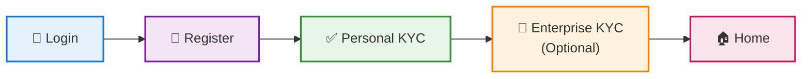

**Key Steps:**
1. User logs in or registers via phone, WeChat, etc.
2. Complete personal real-name authentication (KYC)
3. Optional: Create or join enterprise, complete enterprise authentication
4. Enter system and start using

### Data Flow

#### Request Flow

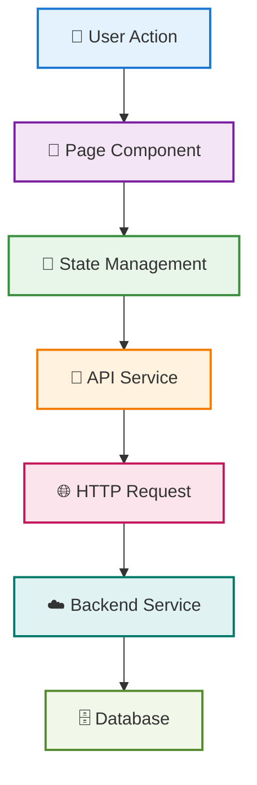

#### Response Flow

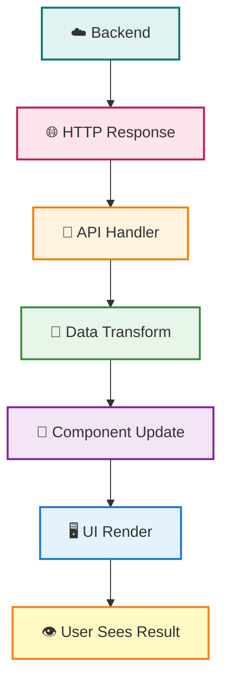

### Typical Business Scenario: Complete Contract Creation Flow

```mermaid
graph LR
    A["👤 User Clicks<br/>Create Contract"] --> B["📄 Select Method<br/>Template/AI/File"]
    B --> C["✏️ Edit Content"]
    C --> D["⚙️ Configure Signers"]
    D --> E["🔌 API Call<br/>contracts.create()"]
    E --> F["🌐 HTTP POST<br/>/sign-task/create"]
    F --> G["☁️ Backend Process<br/>& Save to DB"]
    G --> H["✅ Return Contract ID"]
    H --> I["💾 Update State"]
    I --> J["✨ Show Success"]
    J --> K["🔗 Navigate to Detail"]
    
    style A fill:#e3f2fd,stroke:#1976d2,stroke-width:2px
    style B fill:#f3e5f5,stroke:#7b1fa2,stroke-width:2px
    style C fill:#e8f5e9,stroke:#388e3c,stroke-width:2px
    style D fill:#fff3e0,stroke:#f57c00,stroke-width:2px
    style E fill:#fce4ec,stroke:#c2185b,stroke-width:2px
    style F fill:#e0f2f1,stroke:#00796b,stroke-width:2px
    style G fill:#f1f8e9,stroke:#558b2f,stroke-width:2px
    style H fill:#ede7f6,stroke:#512da8,stroke-width:2px
    style I fill:#fff9c4,stroke:#f57f17,stroke-width:2px
    style J fill:#e1bee7,stroke:#6a1b9a,stroke-width:2px
    style K fill:#e0f7fa,stroke:#006064,stroke-width:2px
```

**Flow Description:**
1. **User Action**: Click create contract button
2. **Select Method**: Choose template, AI draft, file upload or image upload
3. **Edit Content**: Edit contract content
4. **Configure Signing**: Add signers, set signing order
5. **API Call**: Call create contract interface
6. **Backend Processing**: Backend validates data and saves to database
7. **Return Result**: Return newly created contract ID
8. **State Update**: Frontend updates page state
9. **User Feedback**: Show success message
10. **Page Navigation**: Auto-navigate to contract details page

---

## Core Business Modules Explained

### 1. User System Module

#### Feature Overview
- **Login/Register**: Supports multiple methods including SMS verification, account/password, WeChat authorization
- **Real-name Authentication**: Personal KYC authentication with OCR ID card recognition
- **Enterprise Authentication**: Enterprise-level KYC authentication with business license recognition

#### Technical Implementation
```typescript
// KYC authentication component usage example
import KycModal from '@/components/KycModal.uvue';

// Trigger KYC authentication
const showKycModal = () => {
  kycModalRef.value.show();
};
```

#### Page Structure
```
pages/
├── login/index.uvue          // Login page
├── register/index.uvue       // Register page
└── kyc/
    ├── personal/index.uvue   // Personal authentication
    └── enterprise/index.uvue // Enterprise authentication
```

### 2. Contract Management Module

#### Feature Overview
- **Contract Creation**: Supports multiple methods (template, file, image, AI drafting)
- **Contract List**: Display by status (all, pending, completed, rejected, etc.)
- **Draft Management**: Auto-save drafts, support continue editing
- **Contract Details**: View complete contract info, signing progress, operation logs
- **Contract Review**: Approval process management

#### Business Process

##### Contract Creation Flow (Visualization)

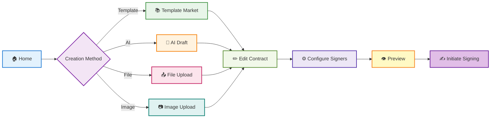

**Process Description:**
1. **Creation Stage**: Supports four creation methods (template, AI, file, image)
2. **Editing Stage**: Unified editor for content adjustment
3. **Configuration Stage**: Set signers, signing order, form fields, etc.
4. **Preview Stage**: Confirm contract content is correct
5. **Initiation Stage**: Officially initiate signing process

##### Complete Signing Flow

```
Create Contract → Configure Signers → Set Signing Order → Initiate Signing
    ↓
Signer Receives Notification → View Contract → Fill Form (optional) → Sign
    ↓
All Parties Complete → Contract Archived → Generate Certificate
```

#### Page Structure
```
pages/
├── contract-manage/
│   ├── index.uvue          // Contract list
│   └── draft.uvue          // Draft box
├── contract-create/
│   ├── setup.uvue          // Creation setup
│   ├── file.uvue           // File upload
│   ├── image.uvue          // Image upload
│   └── h5-create.uvue      // H5 creation page
├── contract-detail/
│   └── index.uvue          // Contract details
├── contract-form/
│   └── h5-fill.uvue        // Form filling
└── contract-review/
    └── index.uvue          // Contract review
```

#### API Interface
```typescript
// Contract-related API
import { contracts } from '@/api/contracts/index';

// Create contract
contracts.create(contractData);

// Get contract list
contracts.list({ status, pageNo, pageSize });

// Get contract details
contracts.detail(contractId);

// Cancel contract
contracts.cancel(contractId);
```

### 3. Contract Signing Module

#### Feature Overview
- **Multi-party Signing**: Supports sequential and parallel signing
- **Signing Methods**: Handwritten signature, seal, riding seal
- **Security Verification**: SMS, email verification, login password
- **Signing Progress**: Real-time signing status

#### Signing Process

##### Contract Signing Flow (Visualization)

```mermaid
graph LR
    A["📋 Contract List"] --> B["📄 Contract Detail"]
    B --> C["🔐 Intent Verification<br/>(Optional)"]
    C --> D["🔏 Select Seal"]
    D --> E{Signing Type}
    E -->|Personal| F["👤 Personal Seal"]
    E -->|Enterprise| G["🏢 Enterprise Seal"]
    
    F --> H["📍 Confirm Position"]
    G --> H
    
    H --> I["✅ Submit Sign"]
    I --> J["⏳ Sign Progress"]
    J --> K["✔️ Sign Complete"]
    K --> L["📥 Download"]
    
    style A fill:#e3f2fd,stroke:#1976d2,stroke-width:2px
    style B fill:#f3e5f5,stroke:#7b1fa2,stroke-width:2px
    style C fill:#ffebee,stroke:#c62828,stroke-width:2px
    style D fill:#e8f5e9,stroke:#388e3c,stroke-width:2px
    style E fill:#fff3e0,stroke:#f57c00,stroke-width:2px
    style F fill:#fce4ec,stroke:#c2185b,stroke-width:2px
    style G fill:#e0f2f1,stroke:#00796b,stroke-width:2px
    style H fill:#f1f8e9,stroke:#558b2f,stroke-width:2px
    style I fill:#ede7f6,stroke:#512da8,stroke-width:2px
    style J fill:#fff9c4,stroke:#f57f17,stroke-width:2px
    style K fill:#e1bee7,stroke:#6a1b9a,stroke-width:2px
    style L fill:#e0f7fa,stroke:#006064,stroke-width:2px
```

**Key Points:**
- Supports intent verification (SMS, email, login password)
- Supports personal signatures and enterprise seals
- Can set signing position (including riding seals)
- Real-time signing progress display
- Download contract after completion

##### Simplified Flow

```
Receive Notification → Open Contract → Intent Verification (optional) → Choose Method
    ↓
Add Signature/Seal → Confirm Position → Submit → Complete
```

#### Page Structure
```
pages/
├── contract-sign/
│   ├── index.uvue          // Signing page
│   └── h5-sign.uvue        // H5 signing page
└── contract-view/
    └── h5-view.uvue        // Contract viewing
```

#### Seal Management API
```typescript
// Seal-related API
import { seals } from '@/api/seals/index';

// Get seal list
seals.getSealList({ identityType, enterpriseId });

// Personal seal operations
seals.userSeal.create(data);
seals.userSeal.update(data);
seals.userSeal.delete(id);
seals.userSeal.page(params);

// Enterprise seal operations
seals.enterpriseSeal.create(data);
seals.enterpriseSeal.update(data);
seals.enterpriseSeal.delete(id);
seals.enterpriseSeal.page(params);

// Enterprise seal authorization
seals.enterpriseSeal.grantCreate(data);
seals.enterpriseSeal.grantDelete(id);
seals.enterpriseSeal.grantList(sealId);
```

### 4. Tianyan Audit Module (AI Intelligent Audit)

#### Feature Overview
- **Risk Identification**: Auto-identify risky clauses
- **Intelligent Analysis**: AI-based contract content analysis
- **Audit Report**: Generate detailed risk analysis report
- **History**: Save audit history

#### Audit Flow (Visualization)

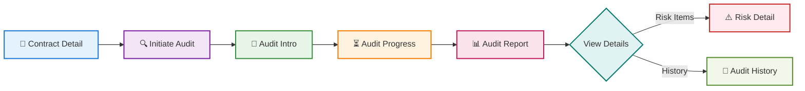

**Key Points:**
- AI-based contract audit service
- Auto-identify and mark risky clauses
- Generate detailed risk analysis report
- Support viewing historical audit records
- Can repeatedly audit the same contract

#### Page Structure
```
pages/contract-audit/
├── intro.uvue          // Audit introduction
├── progress.uvue       // Audit progress
├── report.uvue         // Audit report
├── risk-detail.uvue    // Risk details
└── history.uvue        // Audit history
```

### 5. AI Drafting Module

#### Feature Overview
- **Conversational Drafting**: Generate contracts through natural language
- **Intelligent Editing**: AI-assisted modification and optimization
- **Template Recommendation**: Recommend suitable templates
- **History**: Save drafting history

#### AI Drafting Flow (Visualization)

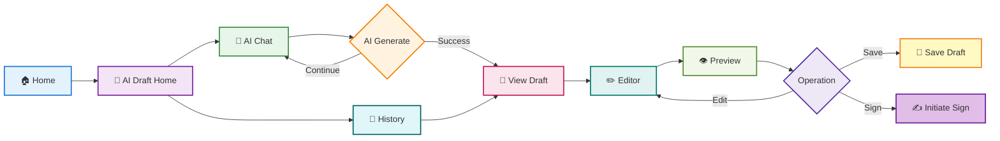

**Key Points:**
- Conversational contract drafting experience
- AI generates contract based on conversation
- Support editing AI-generated content
- Can save as draft or initiate signing directly
- Save history for later review

#### Page Structure
```
pages/ai-draft/
├── index.uvue          // AI drafting home
├── chat.uvue           // AI conversation page
├── editor.uvue         // Editor page
├── detail.uvue         // Details page
├── preview.uvue        // Preview page
└── history.uvue        // History
```

### 6. Template System Module

#### Feature Overview
- **Template Market**: Provide various contract templates
- **Template Categories**: Categorized by industry and purpose
- **Template Details**: View template content and fill items
- **Template Usage**: Quick contract creation based on templates

#### Template Usage Flow (Visualization)

```mermaid
graph LR
    A["🏠 Home"] --> B["📚 Template Market"]
    B --> C{Browse}
    C -->|Filter| B
    C -->|Select| D["📄 Template Detail"]
    
    D --> E["👁️ Template Preview"]
    E --> F{Operation}
    F -->|Use Template| G["✏️ Fill Form"]
    F -->|Back| D
    
    G --> H["📝 Edit Contract"]
    H --> I["✍️ Initiate Sign"]
    
    style A fill:#e3f2fd,stroke:#1976d2,stroke-width:2px
    style B fill:#f3e5f5,stroke:#7b1fa2,stroke-width:2px
    style C fill:#e8f5e9,stroke:#388e3c,stroke-width:2px
    style D fill:#fff3e0,stroke:#f57c00,stroke-width:2px
    style E fill:#fce4ec,stroke:#c2185b,stroke-width:2px
    style F fill:#e0f2f1,stroke:#00796b,stroke-width:2px
    style G fill:#f1f8e9,stroke:#558b2f,stroke-width:2px
    style H fill:#ede7f6,stroke:#512da8,stroke-width:2px
    style I fill:#fff9c4,stroke:#f57f17,stroke-width:2px
```

**Key Points:**
- Browse rich contract template library
- Support filtering by industry and purpose
- Preview template content and fill items
- Quick contract creation based on templates
- Templates include preset signing areas

#### Page Structure
```
pages/
├── template-market/
│   └── index.uvue      // Template market
├── template-detail/
│   └── index.uvue      // Template details
└── template-preview/
    └── index.uvue      // Template preview
```

#### API Interface
```typescript
// Template-related API
import { templates } from '@/api/templates/index';

// Get template list
templates.list({ category, keyword });

// Get template details
templates.detail(templateId);

// Create contract from template
templates.createFromTemplate(templateId, formData);
```

### 7. Enterprise Management Module

#### Feature Overview
- **Enterprise List**: Manage multiple enterprise accounts
- **Enterprise Switching**: Quick switch between enterprises
- **Member Management**: Add, edit, delete members
- **Member Invitation**: Invite via phone/email
- **Role Permissions**: Set member roles and permissions
- **Enterprise Seals**: Create and manage enterprise seals
- **Seal Authorization**: Control member seal usage permissions

#### Enterprise Management Flow (Visualization)

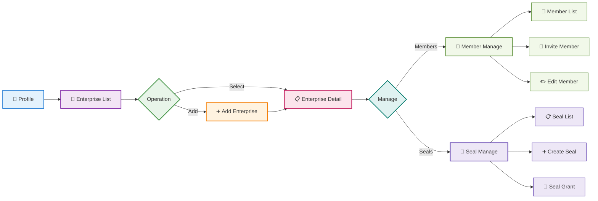

**Key Points:**
- Support multiple enterprise account management
- Member management supports invitation and editing
- Enterprise seal authorization control
- Strict role permission management (Owner/Admin/Member)
- Seal authorization can set usage period and count limits

#### Page Structure
```
pages/enterprise/
├── list.uvue           // Enterprise list
├── add.uvue            // Add enterprise
├── detail.uvue         // Enterprise details
├── members.uvue        // Member management
├── member-invite.uvue  // Invite members
├── member-edit.uvue    // Edit member
├── seals.uvue          // Enterprise seal management
├── seal-create.uvue    // Create enterprise seal
└── seal-authorize.uvue // Seal authorization
```

#### API Interface
```typescript
// Enterprise-related API
import { enterprise } from '@/api/enterprise/index';

// Enterprise operations
enterprise.list();                    // Enterprise list
enterprise.create(enterpriseData);    // Create enterprise
enterprise.detail(enterpriseId);      // Enterprise details
enterprise.update(enterpriseId, data);// Update enterprise

// Member operations
enterprise.members.list(enterpriseId);
enterprise.members.invite(inviteData);
enterprise.members.update(memberId, data);
enterprise.members.remove(memberId);
```

### 8. Personal Center Module

#### Feature Overview
- **Personal Information**: View and edit user profile
- **Personal Seals**: Manage personal signatures and seals
- **Security Settings**: Change password, bind phone/email
- **Notifications**: View system notifications and messages
- **Package Management**: View and upgrade packages
- **Help Center**: FAQs and help documentation
- **About**: Application information and version

#### Page Structure
```
pages/profile/
├── index.uvue          // Personal center home
├── personal-info.uvue  // Personal information
├── seals.uvue          // Personal seal management
├── seal-create.uvue    // Create personal seal
├── settings.uvue       // Settings
├── notifications.uvue  // Notifications
├── packages.uvue       // Package management
├── help.uvue           // Help center
└── about.uvue          // About
```

## Development Guide

### Environment Setup

#### 1. Install Dependencies
```bash
# Install project dependencies
npm install

# Download FontAwesome fonts (for icons)
./scripts/download-fontawesome.sh
```

#### 2. Development Mode
```bash
# Start development server
npm run dev

# Develop for specific platform
npm run dev:h5          # H5
npm run dev:mp-weixin   # WeChat Mini Program
npm run dev:app         # APP
```

#### 3. Build Production
```bash
# Build all platforms
npm run build

# Build specific platform
npm run build:h5
npm run build:mp-weixin
npm run build:app
```

### Page Development Guidelines

#### 1. Page Creation Process
```bash
# 1. Create page file in pages/ directory
pages/new-feature/index.uvue

# 2. Register page in pages.json
{
  "path": "pages/new-feature/index",
  "style": {
    "navigationBarTitleText": "New Feature"
  }
}

# 3. Navigate using uni.navigateTo()
uni.navigateTo({
  url: '/pages/new-feature/index'
});
```

#### 2. Page Template
```vue
<template>
  <view class="page-container">
    <!-- Page content -->
  </view>
</template>

<script setup lang="uts">
// Import dependencies
import { ref, reactive } from 'vue';

// Define reactive data
const data = ref<any>({});

// Page load
onLoad((options: any) => {
  console.log('Page params:', options);
  loadData();
});

// Load data
const loadData = async () => {
  // API call
};
</script>

<style lang="scss" scoped>
.page-container {
  padding: 30rpx;
  background-color: #F7F9FC;
}
</style>
```

### Component Development Guidelines

#### 1. Component Creation
```vue
<!-- components/CustomButton.uvue -->
<template>
  <button class="custom-button" @click="handleClick">
    <slot></slot>
  </button>
</template>

<script setup lang="uts">
// Define Props
interface Props {
  type?: 'primary' | 'default';
  disabled?: boolean;
}

const props = withDefaults(defineProps<Props>(), {
  type: 'default',
  disabled: false
});

// Define Emits
const emit = defineEmits<{
  click: [];
}>();

// Event handler
const handleClick = () => {
  if (!props.disabled) {
    emit('click');
  }
};
</script>

<style lang="scss" scoped>
.custom-button {
  /* Style definition */
}
</style>
```

#### 2. Component Usage
```vue
<template>
  <CustomButton type="primary" @click="handleSubmit">
    Submit
  </CustomButton>
</template>

<script setup lang="uts">
import CustomButton from '@/components/CustomButton.uvue';

const handleSubmit = () => {
  console.log('Submit');
};
</script>
```

### API Call Guidelines

#### 1. API Definition
```typescript
// api/contracts/index.uts
import request from '../index';

// Get contract list
export const getContractList = (params: any) => {
  return request({
    url: '/app-api/seal/sign-task/page',
    method: 'GET',
    params
  });
};

// Create contract
export const createContract = (data: any) => {
  return request({
    url: '/app-api/seal/sign-task/create',
    method: 'POST',
    data
  });
};
```

#### 2. API Usage
```typescript
// Use in page
import { getContractList, createContract } from '@/api/contracts/index';

// Get list
const loadList = async () => {
  try {
    const res = await getContractList({
      pageNo: 1,
      pageSize: 10
    });
    console.log('List data:', res.data);
  } catch (error) {
    console.error('Failed:', error);
    uni.showToast({
      title: 'Load Failed',
      icon: 'none'
    });
  }
};

// Create contract
const createNew = async () => {
  try {
    const res = await createContract({
      title: 'Contract Title',
      // ... other data
    });
    uni.showToast({
      title: 'Created Successfully',
      icon: 'success'
    });
  } catch (error) {
    console.error('Failed:', error);
  }
};
```

### State Management

#### 1. Pinia Store Definition
```typescript
// stores/user.ts
import { defineStore } from 'pinia';

export const useUserStore = defineStore('user', {
  state: () => ({
    userInfo: null,
    token: '',
    isLogin: false
  }),
  
  getters: {
    getUserInfo: (state) => state.userInfo,
    getToken: (state) => state.token
  },
  
  actions: {
    setUserInfo(info: any) {
      this.userInfo = info;
      this.isLogin = true;
    },
    
    logout() {
      this.userInfo = null;
      this.token = '';
      this.isLogin = false;
    }
  }
});
```

#### 2. Store Usage
```typescript
import { useUserStore } from '@/stores/user';

const userStore = useUserStore();

// Get state
const userInfo = userStore.getUserInfo;

// Update state
userStore.setUserInfo({
  id: 1,
  name: 'John'
});
```

### Cross-platform Adaptation

#### 1. Platform Detection
```typescript
// #ifdef H5
// H5 specific code
console.log('This is H5 platform');
// #endif

// #ifdef APP-PLUS
// APP specific code
console.log('This is APP platform');
// #endif

// #ifdef MP-WEIXIN
// WeChat Mini Program specific code
console.log('This is WeChat Mini Program');
// #endif
```

#### 2. H5 Special Handling
```vue
<template>
  <H5LoadingContainer :loading="isLoading">
    <H5ErrorContainer :error="error">
      <!-- Page content -->
    </H5ErrorContainer>
  </H5LoadingContainer>
</template>

<script setup lang="uts">
import H5LoadingContainer from '@/components/H5LoadingContainer.uvue';
import H5ErrorContainer from '@/components/H5ErrorContainer.uvue';

const isLoading = ref(false);
const error = ref(null);
</script>
```

### Style Development

#### 1. Global Style Variables
```scss
// uni.scss
$primary-color: #00C28A;    // Primary color
$text-color: #303133;       // Main text color
$border-color: #DCDFE6;     // Border color
$background-color: #F7F9FC; // Background color
```

#### 2. Responsive Units
```scss
// Use rpx units for responsive design
.container {
  padding: 30rpx;
  font-size: 28rpx;
  width: 750rpx;  // Design width
}
```

### Important Documentation

- **Complete Architecture Doc**: `ARCHITECTURE.md`
- **Component Documentation**: `components/README.md`
- **KYC Usage Guide**: `components/KYC_GUARD_USAGE.md`
- **Enterprise KYC Documentation**: `components/ENTERPRISE_KYC_MODAL_USAGE.md`
- **H5 Service Check**: `components/H5_SERVICE_CHECK_GUIDE.md`
- **Authentication API Documentation**: `API_DOCS_APP_AUTH.md`

### FAQs

#### Q1: How to add a new page?
**A:** 
1. Create `.uvue` file in `pages/` directory
2. Register page route in `pages.json`
3. Navigate using `uni.navigateTo()`

#### Q2: How to call backend API?
**A:** All API calls go through interface functions in `api/` directory to ensure unified request management and error handling.

#### Q3: How to use KYC authentication?
**A:** Refer to `components/KYC_GUARD_USAGE.md` and `components/ENTERPRISE_KYC_MODAL_USAGE.md` documentation.

#### Q4: How to handle H5 compatibility issues?
**A:** Wrap H5 pages with `H5LoadingContainer` and `H5ErrorContainer` components, refer to `components/H5_SERVICE_CHECK_GUIDE.md`.

#### Q5: How to develop cross-platform?
**A:** Use conditional compilation directives (like `#ifdef H5`) to handle platform differences, refer to cross-platform adaptation section in ARCHITECTURE.md.

#### Q6: How to manage global state?
**A:** Use Pinia for state management, create Store modules in `stores/` directory.


Project Screenshots
----

#### User (Moblie)


> Currently supports login via mobile phone number and account in 2 ways;
>
> Currently we support multiple ways to initiate contracts including templates, files, images, etc.;
>
> We also support AI contract drafting;
>
> Tianyan audit is mainly for contract risk review;


> Template center supports pre-setting rich contract templates for users or enterprise employees to select contract templates to quickly create contracts;
>
> Users can clearly understand the data and fields to be filled in the current contract template in the template details, so that they can easily know whether this template matches their needs;


> File upload to create a contract, you can set the corresponding signers, the number of signers here is completely set by the contract initiator;
>
> Support multiple images uploaded and merged into PDF and then create contracts, also can set the corresponding signers, the number of signers here is completely set by the contract initiator;


> After completing the basic information for creating a contract, you can initiate the contract creation;


> Contract management supports tab filtering of contracts with different statuses, and you can also view corresponding contract details by clicking on the contract


> If the contract template requires filling in form information before signing, users need to fill in the form first before they can sign the contract;


> During signing, it supports setting riding seals, free seals, and personal signatures;


> For enhanced signing security, users can enable **intent-based signing** in contract templates. During actual signing, secondary security verification is required before signature submission. Currently supported verification methods include **login password, SMS verification code, and email verification code**.


> User's personal center, supports switching the current enterprise


> Users can freely add real-name enterprises, and the first user who creates an enterprise is the super administrator of that enterprise;
>
> After entering a certain enterprise, it supports enterprise-specific operations such as "contract creation", "contract management", "member management", "seal management", etc.;
>
> At the same time, uncertified enterprises also support enterprise real-name authentication


> Administrators can authorize and manage seals;


> Administrators can also manage members


> Users can create their own seals, supporting upload, handwriting, template generation, etc.


> Enterprise users support uploading and template generation of enterprise seals, and the number of seals of the same type is also limited; 


> Supports intelligent audit of contracts, provides corresponding audit reports, and provides users with intelligent analysis of risk levels for reference;


> For some personalized customers who hope to draft personalized contracts themselves, we currently support intelligent drafting through AI;


> Drafted contract drafts can be edited and adjusted online to better meet your personalized needs;


#### User(PC)

> User web portal, you can sign and view your contracts in the backend


> PC also supports login via mobile phone number + password and SMS verification code;


> The workspace supports viewing basic contract information


> View all contract information, supports online signing and viewing contract progress status


> Create and manage personal seals and enterprise seals by yourself 


 
 

> Administrators support creating contract templates


> Administrators can invite enterprise employees


> View personal basic information


### Recent Updates

##### V 3.2.0

- [x] [New] Word to PDF conversion for contract initiation
- [x] [New] Secure confirmation signing support (intent-based signing via SMS, email, or login password)
- [x] [New] OCR recognition support for personal real-name authentication
- [x] [New] Signature position configuration support
- [x] [Optimized] Enhanced overall user experience and mobile-specific prompts
- [x] [Fixed] Resolved bugs reported in various issues

##### V 3.1.0

- [x] [New] WeChat & WeChat Official Account login now available  
- [x] [New] You can pre-place stamp/seal fields while creating a contract  
- [x] [New] Pick signers straight from your history—no re-typing  
- [x] [Fix] Mini-program compatibility issues resolved  
- [x] [Fix] Faster PDF loading performance  
- [x] [Fix] Various bugs reported in GitHub/other issues


##### V 3.0 Pro Version
- [x] 【New】Brand new page design style
- [x] 【New】Brand new technical architecture
- [x] 【New】Tianyan Audit (Intelligent contract review)
- [x] 【New】AI Drafting (AIGC contract generation)


### Technical Documentation

* Online Demo:
 https://m-sign.leepm.com (moblie) ，https://pc-sign.leepm.com (PC)


### Star Trend

[](https://star-history.com/#freeleepm/mini-contract&Date)


### Communication and Cooperation

If you have any ideas, opinions, or suggestions about the Mini Contract Pro product, or commercial cooperation needs, please scan the code to contact the Mini Contract Pro project team for further communication:


## Product Recognition

> Since the product was open-sourced, it has received attention and recognition from many friends, and we have ultimately reached some in-depth cooperation. Currently, we have cooperated with over 300+ partners, including both "enterprise" friends and some "individual independent developers"


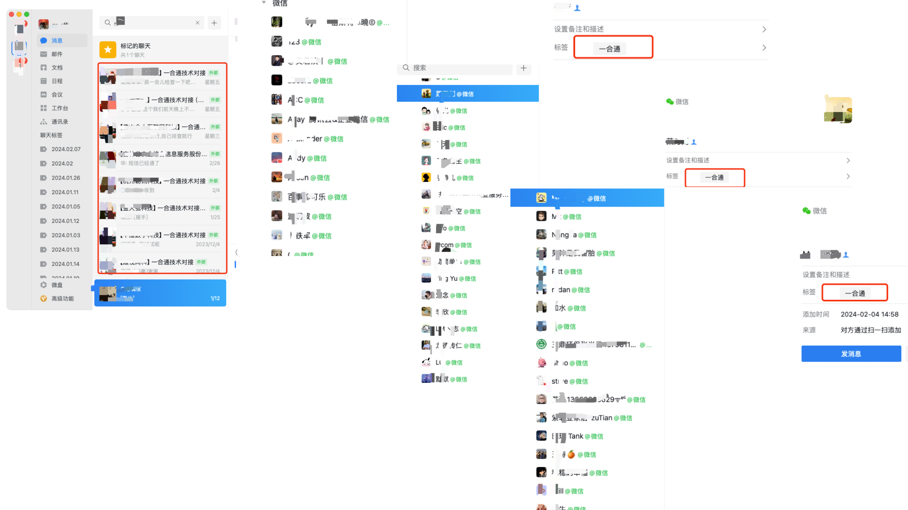
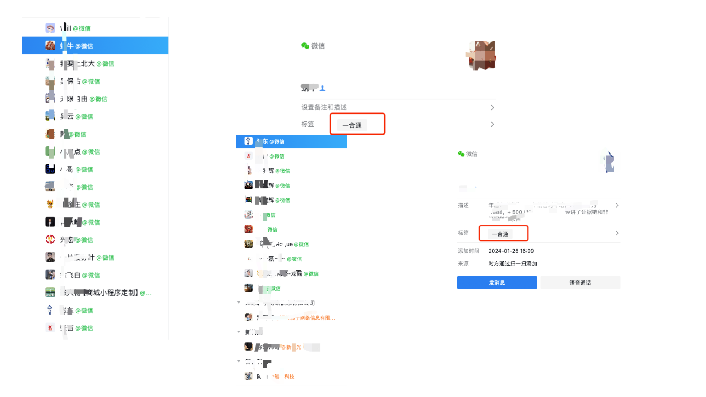
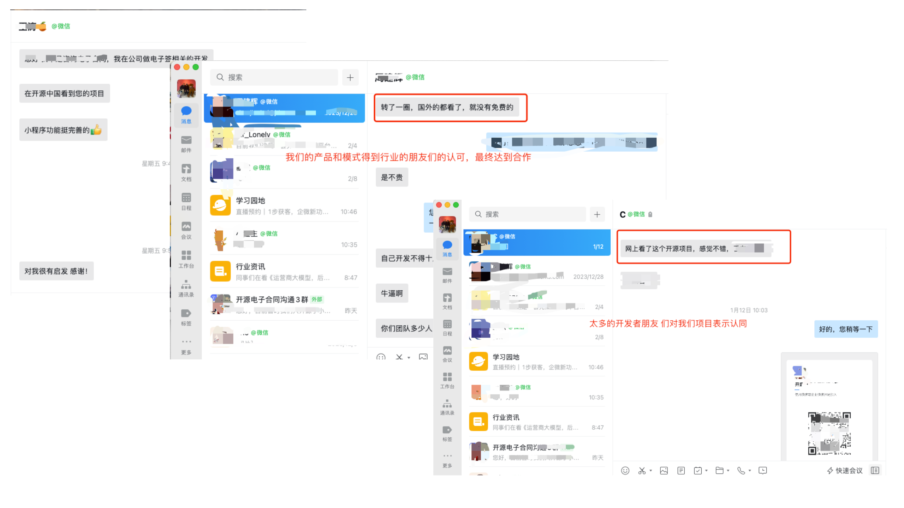
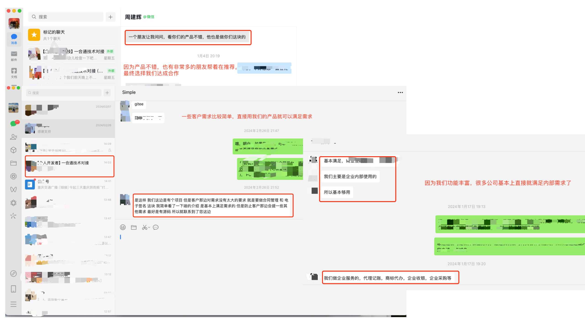
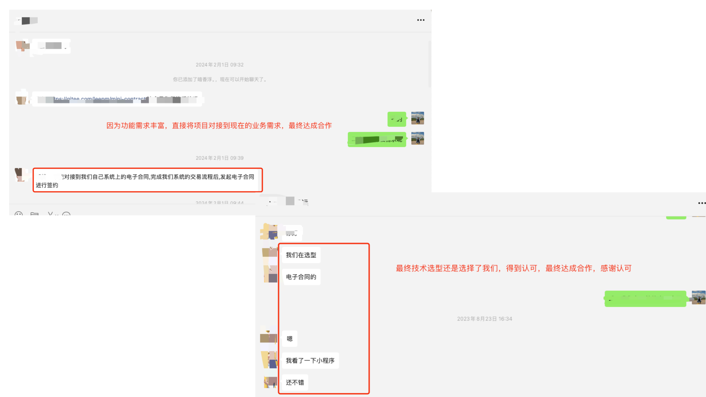


## Support Us

If you think this project is good, please Watch, Star, and Fork it ☺
