  Mini Contract.Pro(免费开源电子合同)
  ===============


当前最新版本：v3.4.0 (发布时间：2026-04-05)

[](https://gitee.com/leepm/mini-contract/blob/master/LICENSE)[](https://gitee.com/leepm/mini-contract)[](https://gitee.com/leepm/mini-contract)[](https://gitee.com/leepm/mini-contract)[](https://gitee.com/leepm/mini-contract)[](https://github.freeleepm/mini-contract)[](https://github.freeleepm/mini-contract)


<h3 align="center">Mini Contract.Pro</h3>


🔥🔥🔥作为一款拥有自主知识产权的免费开源产品，Mini Contract.Pro始终坚持“让数字签约开发更简单”，同时Mini Contract.Pro也是一款专为开发者设计的开源电子签解决方案，创新性地采用「双模式引擎」+「双签署模式」架构，通过模块化设计满足从司法级签约到轻量级协作的全场景需求。首创支持证据链与非证据链双模式的开源电子签平台，同时首创「快捷签署」与「安全签署」双签署模式，让签署方无需注册即可完成签约。我们已帮助 200+企业客户实现合同签署流程的数字化转型。


####  双模式引擎（灵活应对业务场景）

**司法级证据链模式**

基于蚂蚁司法链构建的区块链存证体系，为每份合同生成包含时间戳、数字指纹的存证报告，确保合同符合《电子签名法》要求。该模式已通过国家工业信息安全发展研究中心认证，特别适用于金融、人力资源合同、知识产权协议等高价值场景，存证查询响应速度达毫秒级。


**轻量级非证据链模式**

采用完全自研的分布式存储架构与数字签名技术，集成自签CA证书体系实现端到端加密防篡改保护。通过智能路由算法与分层缓存策略，接口调用成本降低60%，响应速度提升3倍。系统内置完整的审计日志与操作追溯机制，自动记录合同创建、修改、签署全流程关键节点，确保每个操作可追溯、可审计。无需对接第三方存证机构即可实现合同全生命周期管理，特别适合内部审批、供应商对账、快速签约等高频次场景，单日可承载千万级签署请求，是追求高性价比企业的理想选择。


####  双签署模式（首创灵活签署体验）

在「双模式引擎」之上，Mini Contract.Pro 还首创了**双签署模式**，从签署方的身份认证维度提供两种灵活选择：

**快捷签署（Quick Sign）**

无需注册登录，签署方通过签署链接直接进入签署页面。系统为每次签署生成临时安全令牌，签署方仅需验证手机号即可完成签名，全程最快 30 秒内完成。特别适合外部合作方、客户、供应商等非平台用户的签署场景——对方无需下载 APP 或注册账号，点击链接即签，极大降低签署门槛，显著提升签约转化率。

> ⚠️ 快捷签署仅支持**个人身份签署**，不支持以企业身份签署。需要企业签章的场景请使用「安全签署」模式。

**安全签署（Secure Sign）**

签署方需先登录平台并完成实名认证（KYC），通过身份证 + 人脸识别双重验证后方可签署。签署过程与用户账号体系深度绑定，所有操作均关联至已认证的真实身份，确保签署行为具有完整的法律效力。支持个人签署与企业签章，适用于金融合同、劳动合同、股权协议等对身份真实性和法律效力有严格要求的高价值场景。

> 两种签署模式可在同一份合同中混合使用——例如发起方使用「安全签署」（企业签章），而外部签署方使用「快捷签署」（个人签名），兼顾安全性与便捷性。

**两种模式对比：**

| 特性 | 快捷签署 Quick Sign | 安全签署 Secure Sign |
|------|:---:|:---:|
| 需要注册登录 | ✘ | ✔ |
| 需要实名认证（KYC） | ✘ | ✔ |
| 个人签署 | ✔ | ✔ |
| 企业签章 | ✘ | ✔ |
| 适用签署方 | 外部人员、客户、供应商 | 内部员工、企业法人代表 |
| 签署耗时 | 最快 30 秒 | 首次需完成认证 |

#### 签署安全级别设计分析 (sign_security_level)

**原始设计意图**
系统设计了**两层安全级别控制**：
- **全局配置**：`infra_config` 表，key=`seal.sign.default-security-level`（管理后台可改）
- **任务级别**：`seal_sign_task.sign_security_level` 字段（任务创建时快照写入）

**设计思路（快照策略）**：
任务创建时拍一张全局配置的快照，后续流程（链接生成/校验）以任务自身的安全级别为准，不受全局配置后期变更的影响。

**当前挑战**：
若系统初始化时设为“快捷签署”，产生大量任务后，管理员将全局改为“登录签署”以提升安全性。此时“快照策略”会导致旧任务依然维持低安全级别，与管理员“立即收紧权限”的期望相左。

**改进策略：全局底线原则**
本项目采用：`最终安全级别 = max(全局配置, 任务级别)`
- **全局配置是底线**：若全局改为“登录签署”，所有历史任务及链接均立刻要求登录。
- **任务级别可加严**：若全局是“快捷签署”，但某个特定重要任务设为“登录签署”，则该任务依然强制登录。

#### 第三方开发者友好

**即插即用工具集**

* 电子签名/印章云端托管服务

* 多方合同协同编辑（支持50+签署方并行操作）

* 智能骑缝章生成引擎（像素级定位精度）

* 全渠道签署页面（Web/H5/小程序/APP 多端自适应）


**深度开放能力**

* 提供Java/Python/Go多语言SDK

* 开放丰富的API接口


### 为什么选择 Mini Contract Pro？

**一站式集成解决方案**
我们整合了市场上主流的电子合同服务商（包括但不限于法大大、e签宝、君子签等），提供标准化API对接方案。开发者无需逐个对接不同厂商，通过统一接口即可快速接入多家服务，节省90%以上的对接时间。已预置的厂商资质认证体系可帮助您快速通过合规审查。


**成本优化优势**
通过集中采购的规模效应，我们为开发者提供比官方渠道更优惠的接口价格（平均优惠15%-30%）。支持按需选择服务商组合，避免单一厂商绑定风险，真正实现成本可控。


**企业级技术架构**
基于Vue3 + TypeScript + Pinia构建，采用：

- 模块化设计：支持服务商功能按需加载
- 响应式布局：完美适配PC/移动双端
- 配置化开发：90%常见需求可通过配置实现
- 完整类型支持：完善的TS类型定义和接口文档


**快速落地能力（提供开箱即用的解决方案）**

- 标准化UI组件库：含30+经过业务验证的合同模版组件（MIT协议可商用）
- 全链路监控：从合同创建到归档的全过程追踪和存证


### 商业授权

1. 商业版本与开源版本代码一致，没有区分；
2. 商业授权模式为永久授权，支持永久升级；
3. 商业使用需要授权，授权方式可选择联系下方技术同学。


### 开源须知

1. 仅允许用于个人学习研究使用；
2. 禁止将本开源的代码和资源进行任何形式任何名义的出售。


### 核心业务场景

Mini Contract.Pro 已服务 **100+ 企业客户**，覆盖多个行业和场景，以下是典型应用场景：

#### 🏢 人力资源与招聘

**业务痛点**
- 入职合同、劳动合同、保密协议等文档签署量大
- 纸质合同打印、邮寄成本高，周期长
- 异地员工签署不便，影响入职效率
- 合同归档管理困难，查询不便

**解决方案**
- ✅ **批量发起**：支持批量上传员工信息，一键发起签署
- ✅ **模板管理**：预置劳动合同、保密协议等标准模板
- ✅ **移动签署**：员工手机即可完成签署，无需到场
- ✅ **自动归档**：签署完成自动归档，支持按部门、日期检索
- ✅ **到期提醒**：合同到期自动提醒HR续签

**典型客户**：某科技公司月均签署 500+ 份入职合同，效率提升 80%

---

#### 💰 金融

**业务痛点**
- 金融协议、保障性协议等涉及标的大，合规要求高
- 需要严格的法律效力和证据链
- 客户分布广，线下签署成本高
- 合同审核流程长，影响业务流转进度

**解决方案**
- ✅ **司法存证**：基于蚂蚁司法链的区块链存证，确保法律效力
- ✅ **多重验证**：人脸识别 + 短信验证 + 意愿签署，三重保障
- ✅ **审批流程**：支持多级审批，确保合规
- ✅ **风险审查**：天眼审查功能自动识别风险条款
- ✅ **电子签章**：企业公章数字化，远程即可签署

**典型客户**：某公司日均处理 200+ 笔金融协议，业务办理效率提升 60%

---

#### 📊 市场销售与电商

**业务痛点**
- 销售合同、代理协议签署频繁
- 客户分散全国各地，线下签约成本高
- 签约周期长，影响合作落地与结算周期
- 合同版本多，管理混乱

**解决方案**
- ✅ **快速发起**：销售人员手机端 3 分钟完成合同发起
- ✅ **实时跟进**：签署进度实时推送，及时催签
- ✅ **AI 起草**：AI 根据客户需求快速生成个性化合同
- ✅ **电子印章**：客户手机扫码即可完成签署
- ✅ **数据统计**：签约数据可视化，方便管理层决策

**典型客户**：某 SaaS 公司月均签署 1000+ 份销售合同，签约周期缩短 70%

---

#### 🏠 房产租赁与物业

**业务痛点**
- 租赁合同数量多，管理复杂
- 租客频繁更换，合同签署繁琐
- 合同到期难以及时提醒
- 押金条款容易产生纠纷

**解决方案**
- ✅ **模板标准化**：房屋租赁合同、物业服务协议标准模板
- ✅ **到期预警**：租约到期前自动提醒房东和租客
- ✅ **在线续签**：到期后一键续签，无需重新填写信息
- ✅ **图片合同**：支持手写合同拍照上传，快速数字化
- ✅ **押金管理**：押金条款清晰标注，避免纠纷

**典型客户**：某连锁公寓管理 5000+ 间房源，合同管理效率提升 90%

---

#### 🎓 教育培训

**业务痛点**
- 培训协议、学员合同签署量大
- 学员分布广，集中签署不现实
- 退费协议容易产生争议
- 合同存档占用大量空间

**解决方案**
- ✅ **线上报名**：学员报名后自动发起合同签署
- ✅ **家长签字**：未成年人合同支持家长代签
- ✅ **分期协议**：支持培训费分阶段支付协议签署
- ✅ **退费条款**：清晰标注退费规则，减少纠纷
- ✅ **证书管理**：培训证书电子化，随时查看下载

**典型客户**：某在线教育平台年签署 50000+ 份培训协议

---

#### 🏥 医疗健康

**业务痛点**
- 知情同意书、治疗协议等签署紧急
- 患者或家属可能不在现场
- 医疗纠纷取证困难
- 隐私保护要求高

**解决方案**
- ✅ **紧急签署**：支持远程视频 + 电子签名
- ✅ **家属授权**：家属可远程授权签署
- ✅ **区块链存证**：确保证据链完整，便于纠纷处理
- ✅ **隐私保护**：数据加密存储，符合医疗行业规范
- ✅ **批量管理**：体检合同、住院协议批量处理

**典型客户**：某民营医院月均签署 300+ 份医疗协议

---

#### 🚚 物流供应链

**业务痛点**
- 运输合同、货运协议签署频繁
- 司机、货主分散各地
- 合同条款复杂，易产生争议
- 货损赔偿取证困难

**解决方案**
- ✅ **快速签约**：货主、承运方手机端快速签署
- ✅ **条款保护**：货损赔偿条款清晰标注
- ✅ **订单关联**：运输合同与订单系统自动关联
- ✅ **GPS 定位**：签署时记录位置信息
- ✅ **电子回单**：货物签收电子化

**典型客户**：某物流公司日均签署 500+ 份运输合同

---

#### 🏭 制造与代工

**业务痛点**
- 采购合同、代工协议金额大
- 需要多方会签（采购、财务、法务、管理层）
- 合同变更频繁，版本管理困难
- 供应商分布全国，线下签约成本高

**解决方案**
- ✅ **多方会签**：支持 50+ 方并行或顺序签署
- ✅ **审批流程**：灵活配置审批流，确保合规
- ✅ **版本对比**：合同变更自动记录，支持版本对比
- ✅ **供应商管理**：供应商信息自动关联合同
- ✅ **骑缝章**：多页合同支持骑缝章，防篡改

**典型客户**：某制造企业年签署 2000+ 份采购合同，审批效率提升 85%

---

#### 💼 企业服务与外包

**业务痛点**
- 项目外包合同、服务协议签署频繁
- 客户遍布全国，见面签约不现实
- 项目变更需要补充协议
- 合同执行进度难以跟踪

**解决方案**
- ✅ **在线协商**：合同内容可在线协商修改
- ✅ **补充协议**：支持快速生成补充协议
- ✅ **里程碑绑定**：合同与项目里程碑关联
- ✅ **付款条款**：清晰标注付款节点
- ✅ **交付确认**：项目交付电子化确认

**典型客户**：某IT外包公司月均签署 300+ 份服务合同

---

#### 🎨 创意与版权

**业务痛点**
- 版权授权协议、设计合同签署紧迫
- 创作者、甲方可能在不同城市
- 版权条款复杂，易产生争议
- 需要严格的证据链保护原创

**解决方案**
- ✅ **快速签约**：灵感稍纵即逝，即刻签约保护权益
- ✅ **版权存证**：区块链存证，确保版权归属
- ✅ **授权范围**：清晰界定使用范围和期限
- ✅ **分成条款**：明确收益分配比例
- ✅ **违约追责**：完整证据链便于维权

**典型客户**：某设计公司年签署 1000+ 份设计合同和版权协议

---

### 行业覆盖

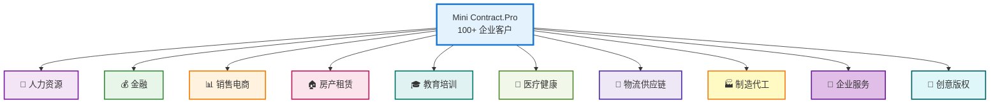

### 核心价值

| 维度 | 传统方式 | Mini Contract.Pro |
|------|---------|-------------------|
| **签署时间** | 3-7 天 | 3-30 分钟 ⚡ |
| **成本** | 打印+邮寄+人工 | 降低 90% 💰 |
| **法律效力** | 需公证 | 区块链存证 🔒 |
| **管理效率** | 人工归档 | 自动归档+智能检索 📊 |
| **异地签署** | 困难 | 随时随地 📱 |
| **合同变更** | 重新签署 | 补充协议 ✏️ |
| **证据保全** | 难以追溯 | 完整操作日志 📝 |


## 系统架构

### 整体架构概述

Mini Contract.Pro 采用现代化的跨平台架构设计，基于 **uni-app + Vue 3 + UTS** 技术栈，通过一套代码实现 iOS、Android、H5、小程序、APP 多端运行。系统采用**前后端分离**架构，前端负责用户交互和业务展示，后端提供 RESTful API 服务。

```
┌─────────────────────────────────────────────────────────┐
│                    用户交互层 (Multi-Platform)            │
│         iOS   │   Android   │   H5   │   小程序         │
└─────────────────────────────────────────────────────────┘
                           ↓
┌─────────────────────────────────────────────────────────┐
│                    前端应用层 (uni-app)                   │
│  ┌──────────────┐  ┌──────────────┐  ┌──────────────┐  │
│  │  页面组件层   │  │  业务逻辑层   │  │  数据管理层   │  │
│  │   (Pages)    │  │  (Services)  │  │   (Pinia)    │  │
│  └──────────────┘  └──────────────┘  └──────────────┘  │
│  ┌──────────────┐  ┌──────────────┐  ┌──────────────┐  │
│  │  公共组件库   │  │   API接口层   │  │  工具函数库   │  │
│  │ (Components) │  │     (API)    │  │   (Utils)    │  │
│  └──────────────┘  └──────────────┘  └──────────────┘  │
└─────────────────────────────────────────────────────────┘
                           ↓
┌─────────────────────────────────────────────────────────┐
│                    网络通信层 (HTTP/HTTPS)                │
└─────────────────────────────────────────────────────────┘
                           ↓
┌─────────────────────────────────────────────────────────┐
│                    后端服务层 (RESTful API)               │
│          用户服务 │ 合同服务 │ 签署服务 │ 企业服务        │
└─────────────────────────────────────────────────────────┘
```

### 核心技术栈

#### 开发环境
- **应用名称**：Mini Contract.Pro
- **框架**：uni-app + Vue 3
- **语言**：UTS (TypeScript)
- **版本**：3.4.0
- **支持平台**：iOS、Android、H5、小程序、APP
- **IDE**：HBuilder

#### 前端技术
- **UI框架**：@dcloudio/uni-ui（官方组件库）
- **状态管理**：Pinia（轻量级、类型安全）
- **样式系统**：SCSS + uni.scss（全局变量管理）
- **图标系统**：CSS Mask + SVG（现代简约风格）
- **构建工具**：@dcloudio/uniapp-cli

#### 核心特性
- **类型安全**：UTS 提供完整的 TypeScript 类型支持
- **响应式设计**：自适应不同屏幕尺寸和设备类型
- **组件化开发**：高度封装、可复用的组件库
- **模块化架构**：清晰的目录结构和职责分离

### 架构分层设计

#### 1. 页面组件层 (pages/)
- **职责**：用户界面展示和交互
- **特点**：按功能模块组织，每个模块独立管理
- **设计原则**：单一职责、高内聚低耦合

#### 2. 公共组件库 (components/)
- **职责**：可复用的 UI 组件
- **特点**：
  - 业务无关的通用组件
  - 高度封装、接口统一
  - 支持插槽和事件通信
- **核心组件**：
  - `KycModal`：KYC认证弹窗
  - `EnterpriseKycModal`：企业KYC认证
  - `H5LoadingContainer`：H5加载容器
  - `H5ErrorContainer`：H5错误处理容器

#### 3. API接口层 (api/)
- **职责**：封装所有后端API调用
- **特点**：
  - 按业务模块分类管理
  - 统一的请求/响应处理
  - 完整的错误处理机制
  - 支持 Mock 数据
- **核心模块**：
  - `auth/`：用户认证
  - `contracts/`：合同管理
  - `enterprise/`：企业管理
  - `seals/`：印章管理
  - `templates/`：模板管理
  - `ai-draft/`：AI起草

#### 4. 工具函数库 (utils/)
- **职责**：通用工具函数
- **核心工具**：
  - `date.uts`：日期处理
  - `network.uts`：网络请求封装
  - `kyc-check.uts`：KYC检查逻辑
  - `download.uts`：文件下载

### 跨端适配策略

#### H5 特殊处理
由于 H5 环境的特殊性（如页面刷新、返回键行为等），系统提供了专门的适配方案：

```typescript
// 使用 H5LoadingContainer 包装 H5 页面
<template>
  <H5LoadingContainer :loading="isLoading">
    <!-- 页面内容 -->
  </H5LoadingContainer>
</template>
```

#### 平台差异处理
```typescript
// 根据平台执行不同逻辑
// #ifdef H5
// H5 特有代码
// #endif

// #ifdef APP-PLUS
// APP 特有代码
// #endif
```

### 数据流与状态管理

#### 数据流向
```
用户操作 → 页面组件 → API调用 → 后端服务
                ↓
            状态更新 → 视图更新
```

#### 状态管理原则
1. **本地状态**：页面级别的临时状态，使用 `reactive` 或 `ref`
2. **全局状态**：跨页面共享的状态，使用 Pinia Store
3. **持久化**：重要数据使用 `uni.setStorage` 持久化

### 目录结构详解

```json
mini-contract-pro/
├── App.uvue                        // 应用配置，全局样式和生命周期管理
├── main.uts                        // 应用入口文件，初始化 Vue 实例
├── index.html                      // H5开发模板
├── manifest.json                   // 应用打包配置（应用名称、appid、版本等）
├── pages.json                      // 页面路由配置、导航栏、选项卡等
├── package.json                    // 项目依赖管理
├── uni.scss                        // SCSS全局变量预置，统一应用风格
├── vue.config.js                   // Vue 开发配置
├── README.md                       // 项目文档
│
├── api/                            // 【API接口层】按功能分类的接口管理
│   ├── index.uts                   // API总入口，导出所有接口
│   ├── auth.uts                    // 认证相关接口
│   ├── config.uts                  // API配置管理（baseURL、超时等）
│   ├── auth/
│   │   └── login.uts               // 登录接口
│   ├── ai-draft/
│   │   └── index.uts               // AI起草相关接口
│   ├── contracts/
│   │   └── index.uts               // 合同管理接口
│   ├── drafts/
│   │   └── index.uts               // 草稿管理接口
│   ├── enterprise/
│   │   └── index.uts               // 企业管理接口
│   ├── seals/
│   │   └── index.uts               // 印章管理接口
│   ├── templates/
│   │   └── index.uts               // 模板管理接口
│   ├── mock/                       // 模拟数据（开发测试用）
│   │   ├── index.uts
│   │   └── templates.uts
│   └── utils/
│       └── download.uts            // 下载工具函数
│
├── components/                     // 【公共组件库】可复用的 UI 组件
│   ├── README.md                   // 组件使用文档
│   ├── KycModal.uvue               // KYC认证弹窗组件
│   ├── EnterpriseKycModal.uvue     // 企业KYC认证弹窗
│   ├── H5LoadingContainer.uvue     // H5加载容器（处理H5特殊性）
│   ├── H5ErrorContainer.uvue       // H5错误容器
│   ├── KYC_GUARD_USAGE.md          // KYC守卫使用指南
│   ├── ENTERPRISE_KYC_MODAL_USAGE.md
│   └── H5_SERVICE_CHECK_GUIDE.md
│
├── pages/                          // 【页面文件】按功能模块组织
│   ├── login/                      // 登录模块
│   │   └── index.uvue
│   ├── register/                   // 注册模块
│   │   └── index.uvue
│   ├── index/                      // 首页
│   │   └── index.uvue
│   │
│   ├── contract-manage/            // 【合同管理模块】
│   │   ├── index.uvue              // 合同列表
│   │   └── draft.uvue              // 草稿箱
│   │
│   ├── contract-create/            // 【合同创建模块】
│   │   ├── setup.uvue              // 创建设置（配置签署人、流程等）
│   │   ├── file.uvue               // 文件上传创建
│   │   ├── image.uvue              // 图片上传创建
│   │   └── h5-create.uvue          // H5专用创建页
│   │
│   ├── contract-detail/            // 【合同详情】
│   │   └── index.uvue
│   │
│   ├── contract-form/              // 【合同表单填写】
│   │   └── h5-fill.uvue            // H5表单填写页
│   │
│   ├── contract-sign/              // 【合同签署模块】
│   │   ├── index.uvue              // 原生签署页
│   │   └── h5-sign.uvue            // H5专用签署页
│   │
│   ├── contract-view/              // 【合同查看】
│   │   └── h5-view.uvue            // H5查看页
│   │
│   ├── contract-review/            // 【合同审核】
│   │   └── index.uvue
│   │
│   ├── contract-audit/             // 【合同审查（天眼审查）】
│   │   ├── intro.uvue              // 审查介绍
│   │   ├── progress.uvue           // 审查进度
│   │   ├── report.uvue             // 审查报告
│   │   ├── risk-detail.uvue        // 风险详情
│   │   └── history.uvue            // 审查历史
│   │
│   ├── ai-draft/                   // 【AI起草模块】
│   │   ├── index.uvue              // AI起草首页
│   │   ├── chat.uvue               // AI对话页
│   │   ├── editor.uvue             // 编辑页
│   │   ├── detail.uvue             // 详情页
│   │   ├── preview.uvue            // 预览页
│   │   └── history.uvue            // 历史记录
│   │
│   ├── template-market/            // 【模板市场】
│   │   └── index.uvue
│   ├── template-detail/            // 【模板详情】
│   │   └── index.uvue
│   ├── template-preview/           // 【模板预览】
│   │   └── index.uvue
│   │
│   ├── enterprise/                 // 【企业管理模块】
│   │   ├── list.uvue               // 企业列表
│   │   ├── add.uvue                // 添加企业
│   │   ├── detail.uvue             // 企业详情
│   │   ├── members.uvue            // 成员管理
│   │   ├── member-invite.uvue      // 邀请成员
│   │   ├── member-edit.uvue        // 编辑成员
│   │   ├── seals.uvue              // 企业印章管理
│   │   ├── seal-create.uvue        // 创建企业印章
│   │   └── seal-authorize.uvue     // 印章授权
│   │
│   ├── profile/                    // 【个人中心模块】
│   │   ├── index.uvue              // 个人中心首页
│   │   ├── personal-info.uvue      // 个人信息
│   │   ├── seals.uvue              // 个人印章管理
│   │   ├── seal-create.uvue        // 创建个人印章
│   │   ├── settings.uvue           // 设置
│   │   ├── notifications.uvue      // 通知
│   │   ├── packages.uvue           // 套餐管理
│   │   ├── help.uvue               // 帮助中心
│   │   └── about.uvue              // 关于应用
│   │
│   ├── kyc/                        // 【KYC认证模块】
│   │   ├── personal/               // 个人认证
│   │   │   └── index.uvue
│   │   └── enterprise/             // 企业认证
│   │       └── index.uvue
│   │
│   ├── agreement/                  // 【协议页面】
│   │   ├── user.uvue               // 用户协议
│   │   └── privacy.uvue            // 隐私政策
│   │
│   └── pdf-preview/                // 【PDF预览】
│       └── index.uvue
│
├── config/                         // 【应用配置】集中管理的全局配置
│   ├── app.config.uts              // 品牌配置（产品名称、版本、版权等）
│   └── seal.config.uts             // 签章业务配置（Token有效期、平台类型等）
│
├── utils/                          // 【工具函数库】通用工具函数
│   ├── date.uts                    // 日期处理工具
│   ├── share.uts                   // 分享工具（小程序分享配置）
│   ├── network.uts                 // 网络请求工具
│   └── kyc-check.uts               // KYC检查工具
│
├── static/                         // 【静态资源】图片、字体等
│   ├── icons/                      // 图标资源
│   ├── images/                     // 图片资源
│   └── fonts/                      // 字体资源
│
├── scripts/                        // 【构建脚本】
│   ├── download-fontawesome.sh     // FontAwesome 字体下载脚本
│   └── sync-app-name.js            // 产品名称同步脚本（同步到 JSON 配置）
│
└── uni_modules/                    // 【uni-app插件模块】
    └── [第三方插件]
```

### 设计理念

#### 1. 模块化设计
- **业务模块独立**：每个业务模块（如合同管理、企业管理）都是独立的文件夹
- **职责单一**：每个文件只负责一个功能
- **易于维护**：模块之间低耦合，修改一个模块不影响其他模块

#### 2. 组件化开发
- **组件复用**：通用组件提取到 `components/` 目录
- **按需加载**：组件按需引入，减少包体积
- **接口统一**：组件通过 props 和 events 通信

#### 3. API 分层
- **接口封装**：所有 API 调用都通过 `api/` 层
- **统一处理**：统一的错误处理、loading 状态、重试机制
- **类型安全**：完整的 TypeScript 类型定义

#### 4. 跨端适配
- **平台检测**：根据运行平台执行不同逻辑
- **特殊处理**：H5 环境特殊处理（loading、error 容器）
- **样式适配**：使用 rpx 单位自适应不同屏幕

---

## 业务流程总览

### 用户认证流程

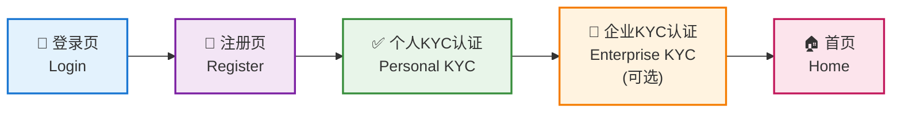

**关键步骤：**
1. 用户通过手机号、微信等方式登录或注册
2. 完成个人实名认证（KYC）
3. 可选：创建或加入企业，完成企业认证
4. 进入系统开始使用

### 数据流向

#### 请求流向

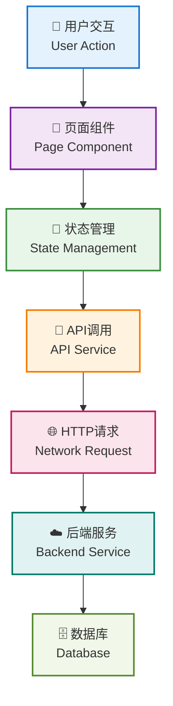

#### 响应流向

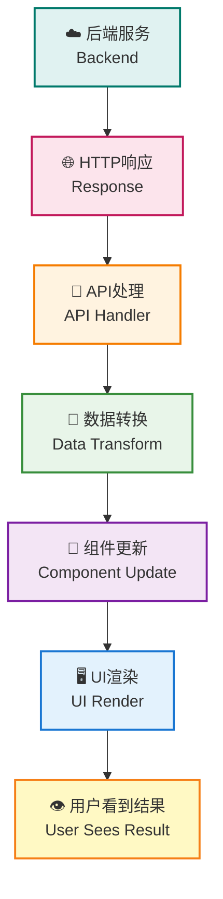

### 典型业务场景：创建合同完整流程

```mermaid
graph LR
    A["👤 用户点击<br/>创建合同"] --> B["📄 选择创建方式<br/>Template/AI/File"]
    B --> C["✏️ 编辑合同<br/>Edit Content"]
    C --> D["⚙️ 配置签署人<br/>Configure Signers"]
    D --> E["🔌 API调用<br/>contracts.create()"]
    E --> F["🌐 HTTP POST<br/>/sign-task/create"]
    F --> G["☁️ 后端处理<br/>& 保存数据库"]
    G --> H["✅ 返回合同ID<br/>Contract ID"]
    H --> I["💾 更新页面状态<br/>Update State"]
    I --> J["✨ 显示成功提示<br/>Show Success"]
    J --> K["🔗 跳转合同详情<br/>Navigate to Detail"]
    
    style A fill:#e3f2fd,stroke:#1976d2,stroke-width:2px
    style B fill:#f3e5f5,stroke:#7b1fa2,stroke-width:2px
    style C fill:#e8f5e9,stroke:#388e3c,stroke-width:2px
    style D fill:#fff3e0,stroke:#f57c00,stroke-width:2px
    style E fill:#fce4ec,stroke:#c2185b,stroke-width:2px
    style F fill:#e0f2f1,stroke:#00796b,stroke-width:2px
    style G fill:#f1f8e9,stroke:#558b2f,stroke-width:2px
    style H fill:#ede7f6,stroke:#512da8,stroke-width:2px
    style I fill:#fff9c4,stroke:#f57f17,stroke-width:2px
    style J fill:#e1bee7,stroke:#6a1b9a,stroke-width:2px
    style K fill:#e0f7fa,stroke:#006064,stroke-width:2px
```

**流程说明：**
1. **用户操作**：点击创建合同按钮
2. **选择方式**：选择模板、AI起草、文件上传或图片上传
3. **编辑内容**：编辑合同内容
4. **配置签署**：添加签署人、设置签署顺序
5. **API调用**：调用创建合同接口
6. **后端处理**：后端验证数据并保存到数据库
7. **返回结果**：返回新创建的合同ID
8. **状态更新**：前端更新页面状态
9. **用户反馈**：显示成功提示
10. **页面跳转**：自动跳转到合同详情页

---

## 核心业务模块详解

### 1. 用户系统模块

#### 功能概述
- **登录/注册**：支持手机号验证码、账号密码、微信授权等多种方式
- **实名认证**：个人KYC认证，支持OCR身份证识别
- **企业认证**：企业级KYC认证，营业执照识别

#### 技术实现
```typescript
// KYC认证组件使用示例
import KycModal from '@/components/KycModal.uvue';

// 触发KYC认证
const showKycModal = () => {
  kycModalRef.value.show();
};
```

#### 页面结构
```
pages/
├── login/index.uvue          // 登录页
├── register/index.uvue       // 注册页
└── kyc/
    ├── personal/index.uvue   // 个人认证
    └── enterprise/index.uvue // 企业认证
```

### 2. 合同管理模块

#### 功能概述
- **合同创建**：支持多种方式（模板、文件、图片、AI起草）
- **合同列表**：分状态展示（全部、待签署、已完成、已拒绝等）
- **草稿管理**：自动保存草稿，支持继续编辑
- **合同详情**：查看合同完整信息、签署进度、操作日志
- **合同审核**：审批流程管理

#### 业务流程

##### 合同创建流程（可视化）

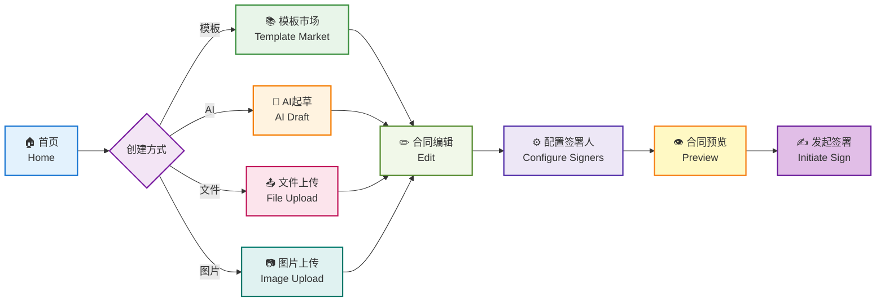

**流程说明：**
1. **创建阶段**：支持四种创建方式（模板、AI、文件、图片）
2. **编辑阶段**：统一进入编辑器进行内容调整
3. **配置阶段**：设置签署人、签署顺序、表单字段等
4. **预览阶段**：确认合同内容无误
5. **发起阶段**：正式发起签署流程

##### 完整签署流程

```
创建合同 → 配置签署人 → 设置签署顺序 → 发起签署
    ↓
签署方接收通知 → 查看合同 → 填写表单（可选）→ 签署
    ↓
所有方签署完成 → 合同归档 → 生成证书
```

#### 页面结构
```
pages/
├── contract-manage/
│   ├── index.uvue          // 合同列表
│   └── draft.uvue          // 草稿箱
├── contract-create/
│   ├── setup.uvue          // 创建设置
│   ├── file.uvue           // 文件上传
│   ├── image.uvue          // 图片上传
│   └── h5-create.uvue      // H5创建页
├── contract-detail/
│   └── index.uvue          // 合同详情
├── contract-form/
│   └── h5-fill.uvue        // 表单填写
└── contract-review/
    └── index.uvue          // 合同审核
```

#### API 接口
```typescript
// 合同相关API
import { contracts } from '@/api/contracts/index';

// 创建合同
contracts.create(contractData);

// 获取合同列表
contracts.list({ status, pageNo, pageSize });

// 获取合同详情
contracts.detail(contractId);

// 撤销合同
contracts.cancel(contractId);
```

### 3. 合同签署模块

#### 功能概述
- **多方签署**：支持顺序签署和并行签署
- **签署方式**：手写签名、印章、骑缝章
- **安全验证**：支持短信验证码、邮箱验证码、登录密码验证
- **签署进度**：实时查看签署状态

#### 签署流程

##### 合同签署流程（可视化）

```mermaid
graph LR
    A["📋 合同列表<br/>Contract List"] --> B["📄 合同详情<br/>Contract Detail"]
    B --> C["🔐 意愿验证<br/>Intent Verification<br/>(可选)"]
    C --> D["🔏 选择签名/印章<br/>Select Seal"]
    D --> E{签署类型}
    E -->|个人| F["👤 个人签名<br/>Personal Seal"]
    E -->|企业| G["🏢 企业印章<br/>Enterprise Seal"]
    
    F --> H["📍 确认签署位置<br/>Confirm Position"]
    G --> H
    
    H --> I["✅ 提交签署<br/>Submit Sign"]
    I --> J["⏳ 签署进度<br/>Sign Progress"]
    J --> K["✔️ 签署完成<br/>Sign Complete"]
    K --> L["📥 下载合同<br/>Download"]
    
    style A fill:#e3f2fd,stroke:#1976d2,stroke-width:2px
    style B fill:#f3e5f5,stroke:#7b1fa2,stroke-width:2px
    style C fill:#ffebee,stroke:#c62828,stroke-width:2px
    style D fill:#e8f5e9,stroke:#388e3c,stroke-width:2px
    style E fill:#fff3e0,stroke:#f57c00,stroke-width:2px
    style F fill:#fce4ec,stroke:#c2185b,stroke-width:2px
    style G fill:#e0f2f1,stroke:#00796b,stroke-width:2px
    style H fill:#f1f8e9,stroke:#558b2f,stroke-width:2px
    style I fill:#ede7f6,stroke:#512da8,stroke-width:2px
    style J fill:#fff9c4,stroke:#f57f17,stroke-width:2px
    style K fill:#e1bee7,stroke:#6a1b9a,stroke-width:2px
    style L fill:#e0f7fa,stroke:#006064,stroke-width:2px
```

**关键点：**
- 支持意愿验证（短信、邮箱、登录密码）
- 支持个人签名和企业印章
- 可设置签署位置（包括骑缝章）
- 实时显示签署进度
- 签署完成后可下载合同

##### 简化流程

```
接收签署通知 → 打开合同 → 意愿验证（可选）→ 选择签署方式
    ↓
添加签名/印章 → 确认签署位置 → 提交签署 → 完成
```

#### 页面结构
```
pages/
├── contract-sign/
│   ├── index.uvue          // 签署页
│   └── h5-sign.uvue        // H5签署页
└── contract-view/
    └── h5-view.uvue        // 合同查看
```

#### 印章管理API
```typescript
// 印章相关API
import { seals } from '@/api/seals/index';

// 获取印章列表
seals.getSealList({ identityType, enterpriseId });

// 个人印章操作
seals.userSeal.create(data);
seals.userSeal.update(data);
seals.userSeal.delete(id);
seals.userSeal.page(params);

// 企业印章操作
seals.enterpriseSeal.create(data);
seals.enterpriseSeal.update(data);
seals.enterpriseSeal.delete(id);
seals.enterpriseSeal.page(params);

// 企业印章授权
seals.enterpriseSeal.grantCreate(data);
seals.enterpriseSeal.grantDelete(id);
seals.enterpriseSeal.grantList(sealId);
```

### 4. 天眼审查模块（AI智能审核）

#### 功能概述
- **风险识别**：自动识别合同中的风险条款
- **智能分析**：基于AI的合同内容分析
- **审查报告**：生成详细的风险分析报告
- **历史记录**：保存审查历史

#### 审查流程（可视化）

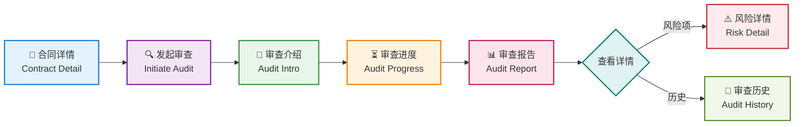

**关键点：**
- 基于AI的合同审查服务
- 自动识别风险条款并标注
- 生成详细的风险分析报告
- 支持查看历史审查记录
- 可重复审查同一合同

#### 页面结构
```
pages/contract-audit/
├── intro.uvue          // 审查介绍
├── progress.uvue       // 审查进度
├── report.uvue         // 审查报告
├── risk-detail.uvue    // 风险详情
└── history.uvue        // 审查历史
```

### 5. AI起草模块

#### 功能概述
- **对话式起草**：通过自然语言描述需求，AI生成合同
- **智能编辑**：AI辅助修改和优化合同内容
- **模板推荐**：根据需求推荐合适的模板
- **历史记录**：保存起草历史

#### AI起草流程（可视化）

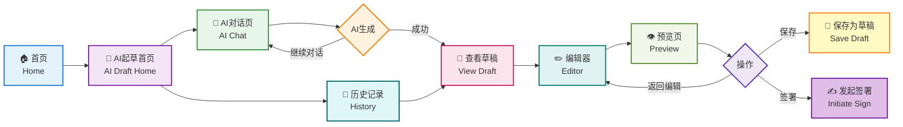

**关键点：**
- 对话式的合同起草体验
- AI根据对话内容生成合同
- 支持编辑AI生成的内容
- 可保存为草稿或直接发起签署
- 保存历史记录便于后续查看

#### 页面结构
```
pages/ai-draft/
├── index.uvue          // AI起草首页
├── chat.uvue           // AI对话页
├── editor.uvue         // 编辑页
├── detail.uvue         // 详情页
├── preview.uvue        // 预览页
└── history.uvue        // 历史记录
```

### 6. 模板系统模块

#### 功能概述
- **模板市场**：提供各类合同模板
- **模板分类**：按行业、用途分类
- **模板详情**：查看模板内容和填写项
- **模板使用**：基于模板快速创建合同

#### 模板使用流程（可视化）

```mermaid
graph LR
    A["🏠 首页<br/>Home"] --> B["📚 模板市场<br/>Template Market"]
    B --> C{浏览}
    C -->|分类筛选| B
    C -->|选择| D["📄 模板详情<br/>Template Detail"]
    
    D --> E["👁️ 模板预览<br/>Template Preview"]
    E --> F{操作}
    F -->|使用模板| G["✏️ 填写表单<br/>Fill Form"]
    F -->|返回| D
    
    G --> H["📝 编辑合同<br/>Edit Contract"]
    H --> I["✍️ 发起签署<br/>Initiate Sign"]
    
    style A fill:#e3f2fd,stroke:#1976d2,stroke-width:2px
    style B fill:#f3e5f5,stroke:#7b1fa2,stroke-width:2px
    style C fill:#e8f5e9,stroke:#388e3c,stroke-width:2px
    style D fill:#fff3e0,stroke:#f57c00,stroke-width:2px
    style E fill:#fce4ec,stroke:#c2185b,stroke-width:2px
    style F fill:#e0f2f1,stroke:#00796b,stroke-width:2px
    style G fill:#f1f8e9,stroke:#558b2f,stroke-width:2px
    style H fill:#ede7f6,stroke:#512da8,stroke-width:2px
    style I fill:#fff9c4,stroke:#f57f17,stroke-width:2px
```

**关键点：**
- 浏览丰富的合同模板库
- 支持按行业和用途分类筛选
- 预览模板内容和填写项
- 快速基于模板创建合同
- 模板包含预设的签署区域

#### 页面结构
```
pages/
├── template-market/
│   └── index.uvue      // 模板市场
├── template-detail/
│   └── index.uvue      // 模板详情
└── template-preview/
    └── index.uvue      // 模板预览
```

#### API 接口
```typescript
// 模板相关API
import { templates } from '@/api/templates/index';

// 获取模板列表
templates.list({ category, keyword });

// 获取模板详情
templates.detail(templateId);

// 使用模板创建合同
templates.createFromTemplate(templateId, formData);
```

### 7. 企业管理模块

#### 功能概述
- **企业列表**：管理多个企业账户
- **企业切换**：快速切换当前企业
- **成员管理**：添加、编辑、删除企业成员
- **成员邀请**：通过手机号/邮箱邀请成员
- **角色权限**：设置成员角色和权限
- **企业印章**：创建和管理企业印章
- **印章授权**：控制成员印章使用权限

#### 企业管理流程（可视化）

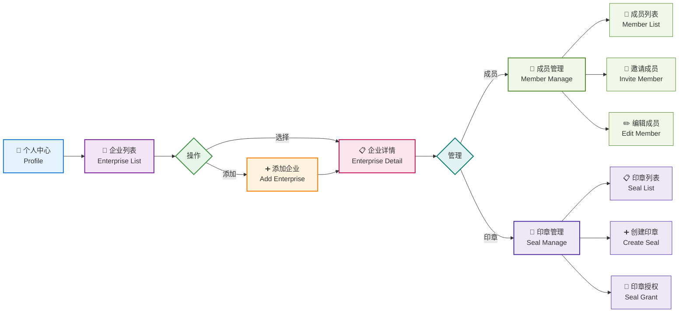

**关键点：**
- 支持多企业账户管理
- 成员管理支持邀请和编辑
- 企业印章支持授权控制
- 角色权限严格管理（所有者/管理员/成员）
- 印章授权可设置使用期限和次数限制

#### 页面结构
```
pages/enterprise/
├── list.uvue           // 企业列表
├── add.uvue            // 添加企业
├── detail.uvue         // 企业详情
├── members.uvue        // 成员管理
├── member-invite.uvue  // 邀请成员
├── member-edit.uvue    // 编辑成员
├── seals.uvue          // 企业印章管理
├── seal-create.uvue    // 创建企业印章
└── seal-authorize.uvue // 印章授权
```

#### API 接口
```typescript
// 企业相关API
import { enterprise } from '@/api/enterprise/index';

// 企业操作
enterprise.list();                    // 企业列表
enterprise.create(enterpriseData);    // 创建企业
enterprise.detail(enterpriseId);      // 企业详情
enterprise.update(enterpriseId, data);// 更新企业

// 成员操作
enterprise.members.list(enterpriseId);
enterprise.members.invite(inviteData);
enterprise.members.update(memberId, data);
enterprise.members.remove(memberId);
```

### 8. 个人中心模块

#### 功能概述
- **个人信息**：查看和编辑用户资料
- **个人印章**：管理个人签名和印章
- **安全设置**：修改密码、绑定手机/邮箱
- **消息通知**：查看系统通知和消息
- **套餐管理**：查看和升级套餐
- **帮助中心**：常见问题和帮助文档
- **关于应用**：应用信息和版本

#### 页面结构
```
pages/profile/
├── index.uvue          // 个人中心首页
├── personal-info.uvue  // 个人信息
├── seals.uvue          // 个人印章管理
├── seal-create.uvue    // 创建个人印章
├── settings.uvue       // 设置
├── notifications.uvue  // 通知
├── packages.uvue       // 套餐管理
├── help.uvue           // 帮助中心
└── about.uvue          // 关于应用
```

## 开发指南

### 环境搭建

#### 1. 安装依赖
```bash
# 安装项目依赖
npm install

# 下载 FontAwesome 字体（用于图标）
./scripts/download-fontawesome.sh
```

#### 2. 开发模式
```bash
# 启动开发服务器
npm run dev

# 开发特定平台
npm run dev:h5          # H5
npm run dev:mp-weixin   # 微信小程序
npm run dev:app         # APP
```

#### 3. 构建生产版本
```bash
# 构建所有平台
npm run build

# 构建特定平台
npm run build:h5
npm run build:mp-weixin
npm run build:app
```

#### 4. 品牌配置（产品名称修改）

项目的产品名称、版本号、口号等品牌信息统一在 `config/app.config.uts` 中管理，所有页面均从此文件引用。

**修改产品名称：**

```bash
# 1. 编辑 config/app.config.uts，修改 APP_NAME 等常量
# 2. 运行同步脚本，将名称同步到 manifest.json / pages.json / package.json
npm run sync-name
```

> **说明：** 通过 CLI 构建（`npm run dev` / `npm run build`）时会自动同步，无需手动执行。
> HBuilderX 编译不会触发 npm 钩子，修改名称后需手动执行一次 `npm run sync-name`。

**配置文件说明：**

| 文件 | 用途 |
|------|------|
| `config/app.config.uts` | 品牌信息唯一入口（名称、版本、口号、版权等） |
| `config/seal.config.uts` | 签章业务配置（Token 有效期、平台类型） |
| `api/config.uts` | API 接口配置（环境地址、超时时间等） |

### 页面开发规范

#### 1. 页面创建流程
```bash
# 1. 在 pages/ 目录下创建页面文件
pages/new-feature/index.uvue

# 2. 在 pages.json 中注册页面
{
  "path": "pages/new-feature/index",
  "style": {
    "navigationBarTitleText": "新功能"
  }
}

# 3. 使用 uni.navigateTo() 跳转
uni.navigateTo({
  url: '/pages/new-feature/index'
});
```

#### 2. 页面模板
```vue
<template>
  <view class="page-container">
    <!-- 页面内容 -->
  </view>
</template>

<script setup lang="uts">
// 导入依赖
import { ref, reactive } from 'vue';

// 定义响应式数据
const data = ref<any>({});

// 页面加载
onLoad((options: any) => {
  console.log('页面参数:', options);
  loadData();
});

// 加载数据
const loadData = async () => {
  // API 调用
};
</script>

<style lang="scss" scoped>
.page-container {
  padding: 30rpx;
  background-color: #F7F9FC;
}
</style>
```

### 组件开发规范

#### 1. 组件创建
```vue
<!-- components/CustomButton.uvue -->
<template>
  <button class="custom-button" @click="handleClick">
    <slot></slot>
  </button>
</template>

<script setup lang="uts">
// 定义 Props
interface Props {
  type?: 'primary' | 'default';
  disabled?: boolean;
}

const props = withDefaults(defineProps<Props>(), {
  type: 'default',
  disabled: false
});

// 定义 Emits
const emit = defineEmits<{
  click: [];
}>();

// 事件处理
const handleClick = () => {
  if (!props.disabled) {
    emit('click');
  }
};
</script>

<style lang="scss" scoped>
.custom-button {
  /* 样式定义 */
}
</style>
```

#### 2. 组件使用
```vue
<template>
  <CustomButton type="primary" @click="handleSubmit">
    提交
  </CustomButton>
</template>

<script setup lang="uts">
import CustomButton from '@/components/CustomButton.uvue';

const handleSubmit = () => {
  console.log('提交');
};
</script>
```

### API 调用规范

#### 1. API 定义
```typescript
// api/contracts/index.uts
import request from '../index';

// 获取合同列表
export const getContractList = (params: any) => {
  return request({
    url: '/app-api/seal/sign-task/page',
    method: 'GET',
    params
  });
};

// 创建合同
export const createContract = (data: any) => {
  return request({
    url: '/app-api/seal/sign-task/create',
    method: 'POST',
    data
  });
};
```

#### 2. API 使用
```typescript
// 页面中使用
import { getContractList, createContract } from '@/api/contracts/index';

// 获取列表
const loadList = async () => {
  try {
    const res = await getContractList({
      pageNo: 1,
      pageSize: 10
    });
    console.log('列表数据:', res.data);
  } catch (error) {
    console.error('获取失败:', error);
    uni.showToast({
      title: '加载失败',
      icon: 'none'
    });
  }
};

// 创建合同
const createNew = async () => {
  try {
    const res = await createContract({
      title: '合同标题',
      // ... 其他数据
    });
    uni.showToast({
      title: '创建成功',
      icon: 'success'
    });
  } catch (error) {
    console.error('创建失败:', error);
  }
};
```

### 状态管理

#### 1. Pinia Store 定义
```typescript
// stores/user.ts
import { defineStore } from 'pinia';

export const useUserStore = defineStore('user', {
  state: () => ({
    userInfo: null,
    token: '',
    isLogin: false
  }),
  
  getters: {
    getUserInfo: (state) => state.userInfo,
    getToken: (state) => state.token
  },
  
  actions: {
    setUserInfo(info: any) {
      this.userInfo = info;
      this.isLogin = true;
    },
    
    logout() {
      this.userInfo = null;
      this.token = '';
      this.isLogin = false;
    }
  }
});
```

#### 2. Store 使用
```typescript
import { useUserStore } from '@/stores/user';

const userStore = useUserStore();

// 获取状态
const userInfo = userStore.getUserInfo;

// 更新状态
userStore.setUserInfo({
  id: 1,
  name: '张三'
});
```

### 跨端适配

#### 1. 平台判断
```typescript
// #ifdef H5
// H5 特有代码
console.log('这是 H5 平台');
// #endif

// #ifdef APP-PLUS
// APP 特有代码
console.log('这是 APP 平台');
// #endif

// #ifdef MP-WEIXIN
// 微信小程序特有代码
console.log('这是微信小程序');
// #endif
```

#### 2. H5 特殊处理
```vue
<template>
  <H5LoadingContainer :loading="isLoading">
    <H5ErrorContainer :error="error">
      <!-- 页面内容 -->
    </H5ErrorContainer>
  </H5LoadingContainer>
</template>

<script setup lang="uts">
import H5LoadingContainer from '@/components/H5LoadingContainer.uvue';
import H5ErrorContainer from '@/components/H5ErrorContainer.uvue';

const isLoading = ref(false);
const error = ref(null);
</script>
```

### 样式开发

#### 1. 全局样式变量
```scss
// uni.scss
$primary-color: #00C28A;    // 主题色
$text-color: #303133;       // 主文本色
$border-color: #DCDFE6;     // 边框色
$background-color: #F7F9FC; // 背景色
```

#### 2. 响应式单位
```scss
// 使用 rpx 单位自适应屏幕
.container {
  padding: 30rpx;
  font-size: 28rpx;
  width: 750rpx;  // 设计稿宽度
}
```

### 重要文档

- **完整架构文档**：`ARCHITECTURE.md`
- **组件文档**：`components/README.md`
- **KYC使用指南**：`components/KYC_GUARD_USAGE.md`
- **企业KYC文档**：`components/ENTERPRISE_KYC_MODAL_USAGE.md`
- **H5服务检查**：`components/H5_SERVICE_CHECK_GUIDE.md`
- **认证API文档**：`API_DOCS_APP_AUTH.md`

### 常见问题

#### Q1: 如何添加新页面？
**A:** 
1. 在 `pages/` 目录下创建 `.uvue` 文件
2. 在 `pages.json` 中注册页面路由
3. 使用 `uni.navigateTo()` 进行跳转

#### Q2: 如何调用后端API？
**A:** 所有 API 调用通过 `api/` 目录下的接口函数进行，确保统一的请求管理和错误处理。

#### Q3: 如何使用KYC认证？
**A:** 参考 `components/KYC_GUARD_USAGE.md` 和 `components/ENTERPRISE_KYC_MODAL_USAGE.md` 文档。

#### Q4: 如何处理H5兼容性问题？
**A:** 使用 `H5LoadingContainer` 和 `H5ErrorContainer` 组件包装 H5 页面，参考 `components/H5_SERVICE_CHECK_GUIDE.md`。

#### Q5: 如何进行跨端开发？
**A:** 使用条件编译指令（如 `#ifdef H5`）处理平台差异，参考 ARCHITECTURE.md 中的跨端适配章节。

#### Q6: 如何管理全局状态？
**A:** 使用 Pinia 进行状态管理，在 `stores/` 目录下创建 Store 模块。


## 项目效果

#### 用户端（移动端=H5/小程序/APP）

----


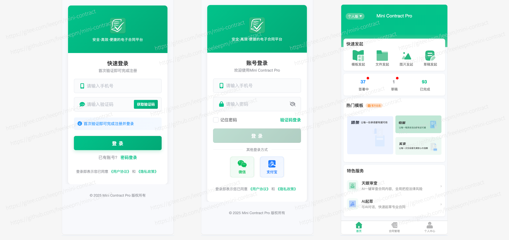

> 1. 登录方式 
>“手机号一键登录、微信扫一下、验证码 3 秒搞定，不用记密码也能进门。”
> 
> 2. 发起合同
>“PDF、手机相册里的图片，甚至一句话，都能秒变正式合同，30 秒就能发出去。”
> 
> 3. AI 起草 
>“不会写合同？直接告诉 AI 你要‘租房子’‘招兼职’，它 10 秒给你一份专业稿子，改都不用改。”
> 
> 4. 天眼审核
>“合同写好了，点一下‘天眼审核’，风险条款自动标红，哪句可能坑你，一眼看见。”


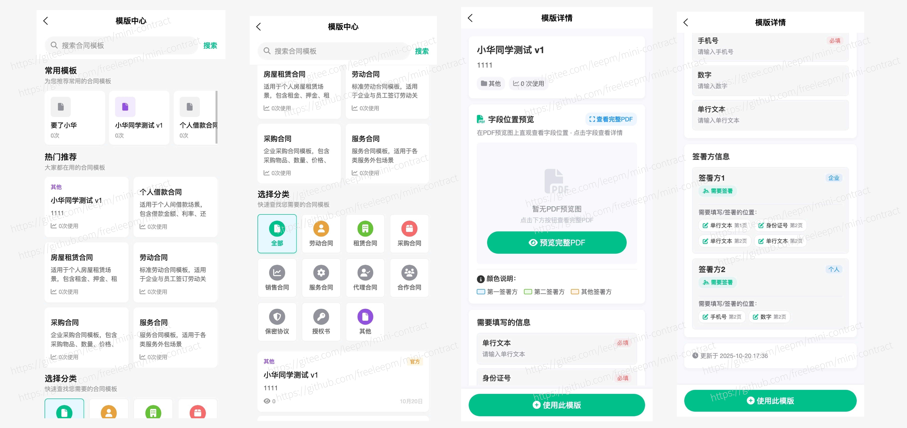

> 1. 模板中心 
> “进来就像逛超市：销售、租赁、劳务……几百份合同模板排排站，看中哪个点哪个，3 秒就能开写。”
>
> 2. 模板详情页 
> “点进去，合同正文瞬间展开，哪条要填、哪条不改，一眼看清；30 秒就能判断这份模板是不是你想要的，零下载、零试错。”


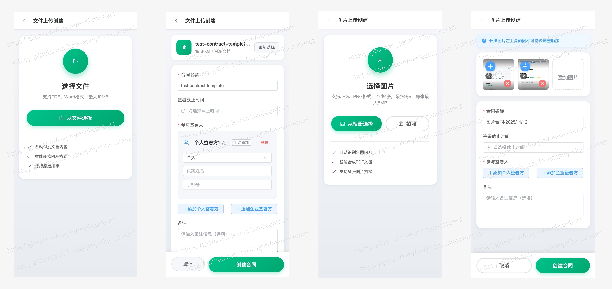

> 1. 文件上传创建合同 
> “把现成的合同文件拖进来，想加几个签署人就加几个，人数、顺序全由你说了算，一秒完成设置。”
>
> 2. 图片合并创建合同 
> “手机拍的、扫描的、截屏的……一次性选多张图，系统自动合成一份标准 PDF，再按你的需求随意添加签署人，几张图也能秒变正式合同。”


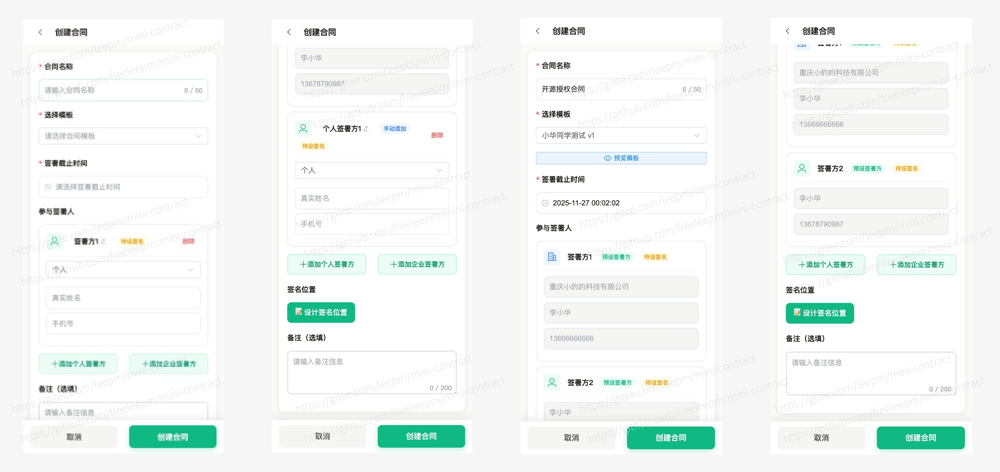
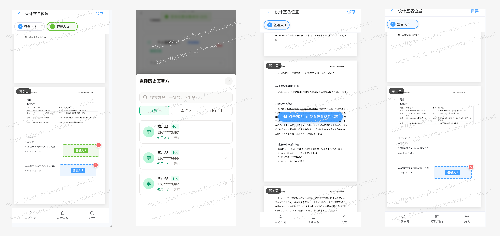

> 1. 模板创建 
> “选好模板先‘试看’：快速查看合同内容与合同信息，帮你快速做选择。”
>
> 2. 签名位置预拖 
> “生成前把签名框拖到想落章的地方（甲方、乙方、骑缝章……），谁签、签哪儿一次设好，后面系统会自动把章精准盖到位。”
>
> 3. 模板自带签署人 
> “如果模板里已经写好了‘甲方××公司、乙方××人’，系统会自动把这些人加到签署列表，你无需再敲一遍。”
>
> 4. 签收人记忆 
> “填过的姓名、手机号、企业名，系统悄悄帮你存进通讯录；下次再发合同，输入首字母就能秒带出，告别重复打字。”


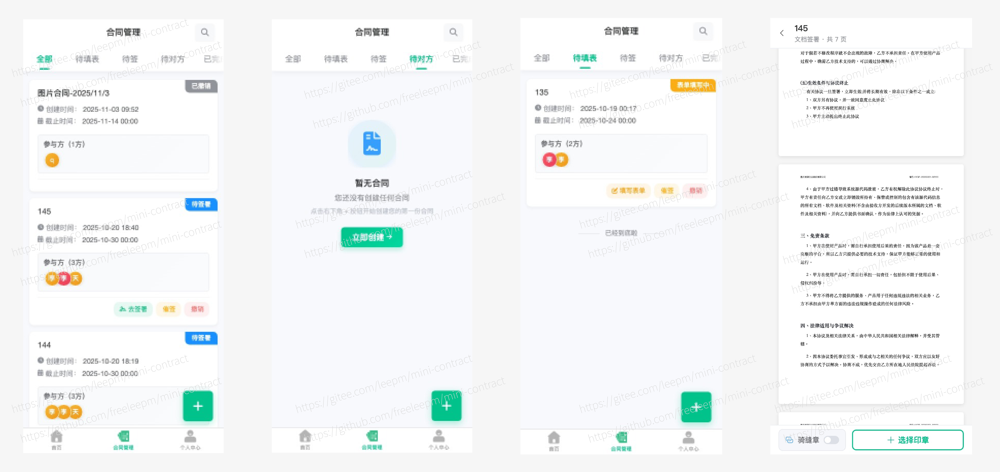

> 合同管理支持不同状态的合同进行 tab 筛选，同时点击合同也能查看相应的合同明细


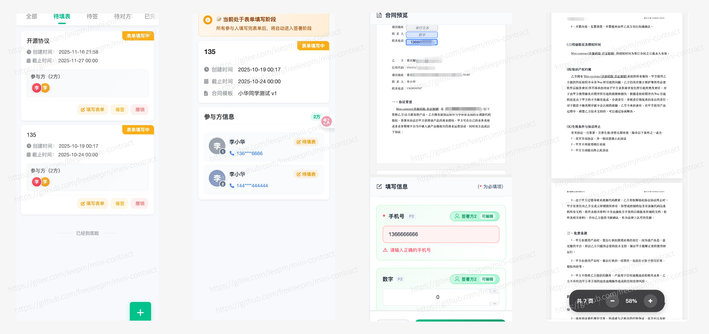

> 如果合同模版里面设置了在签署之前要填写表单信息，这个时候需要用户先填写完表单之后才能进行合同的签署；


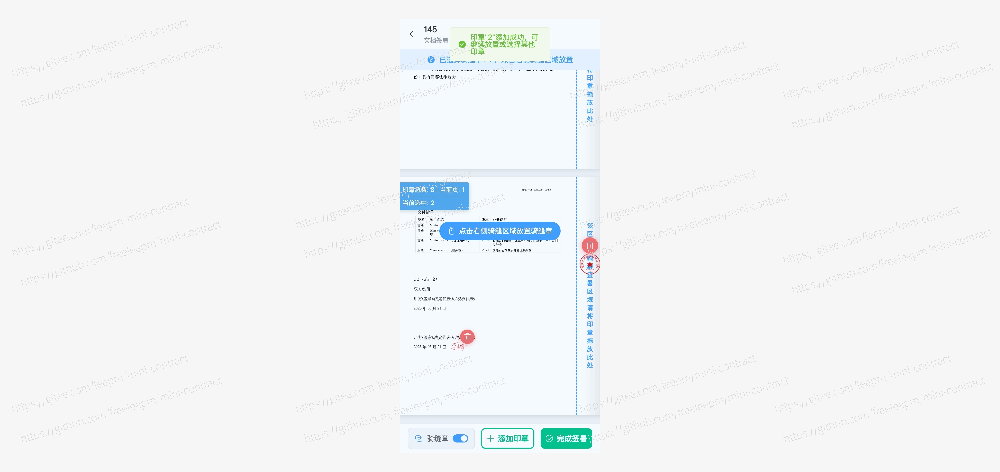

> 在签署的时候支持骑缝章和自由印章和个人签署的设置；


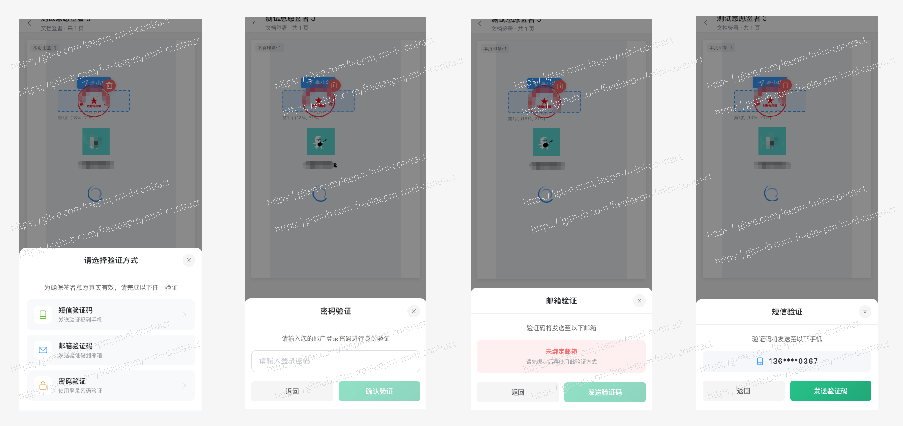
> 为了签署安全，用户可以在合同模版里面设置意愿签署，然后用户在真实签署的时候就需要进行二次安全确认之后才能进行提交签署，二次验证目前支持（登录密码、手机验证码、邮箱验证码）


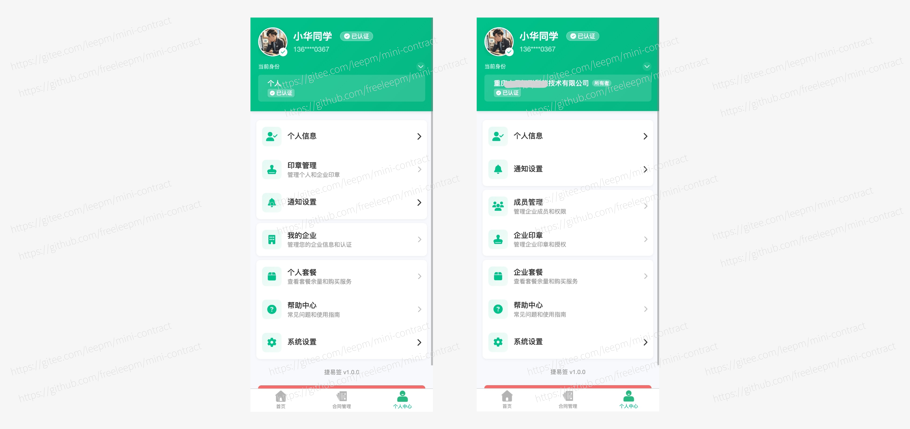

> 用户的个人中心，支持切换当前企业


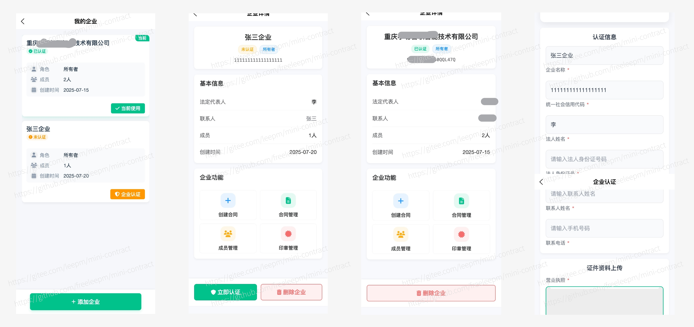

> 1. 新增企业
> “新绑定公司，完成基本信息的填写之后完成企业认证之后；第一个注册的人自动升级为超级管理员，拥有最高权限。”
>
> 2. 企业专属后台
> “进入企业=进自己办公室：发合同、管合同、加成员、管印章，所有操作只在该企业内生效，数据互不串门。”
>
> 3. 一键实名认证
> “企业还没认证？点‘去认证’，上传营业执照+法人信息，审核通过后秒变‘已认证’，印章、合同立刻拥有法律效力。”


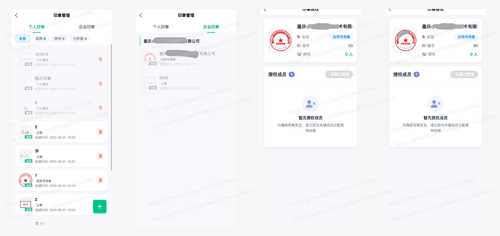

> 1. 印章授权
> “管理员一键把公司公章、合同章‘递’给指定员工，谁有权盖章、用哪枚章，5 秒配好。”
>
> 2. 印章停用
> “员工离职或岗位变动，管理员立刻‘一键冻结’印章，秒停秒生效，再也盖不了，零风险。”


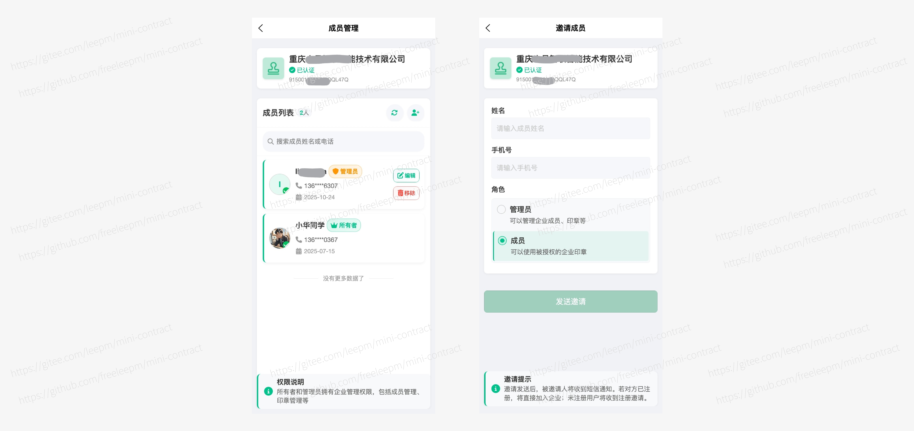

> 管理人员也能对成员进行管理


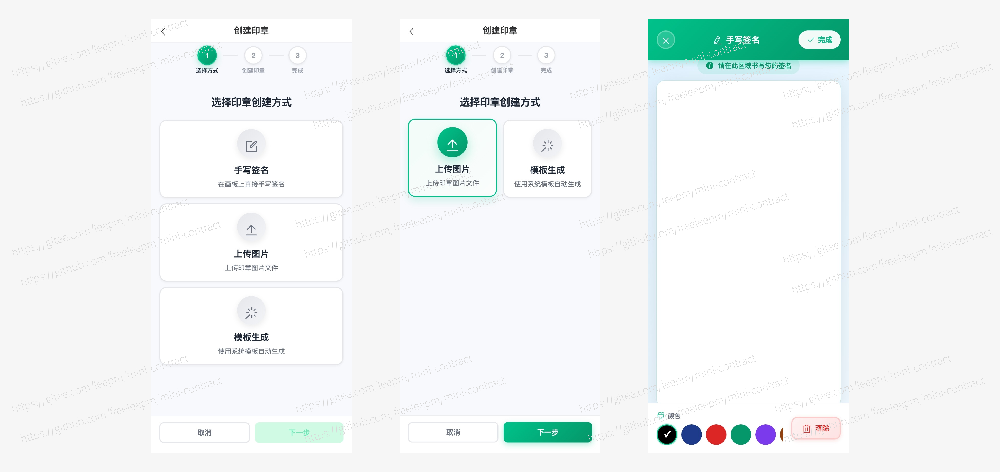

> 用户可以创建自己的印章，支持上传、手写、模版生成等方式


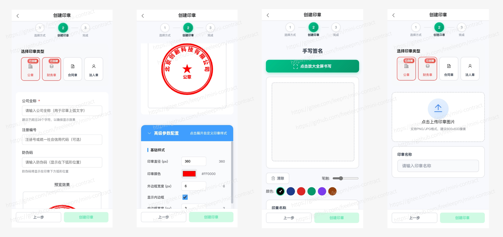

> 企业用户支持上传、模版生成企业印章，同时同一类型的印章也是做了数量限制的； 


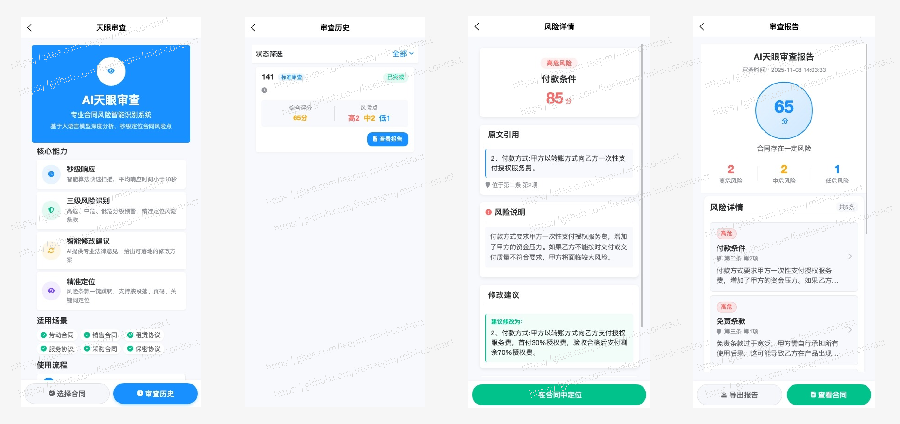

> 支持对合同进行智能审核，并给出相应的审核报告，同时对风险等级进行智能分析提供用户参考；


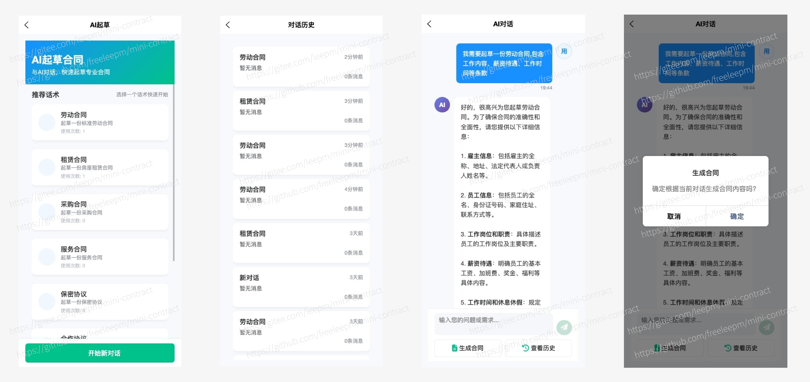

> 针对一些个性化客户，希望自己起草个性化的合同，目前是支持我们通过 ai 来进行智能起草；


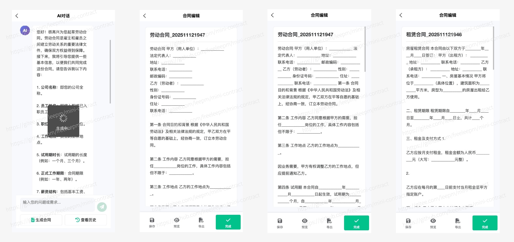

> 针对已经起草的合同初稿可以进行在线编辑与调整，使期更加的满足自己的个性化需求；


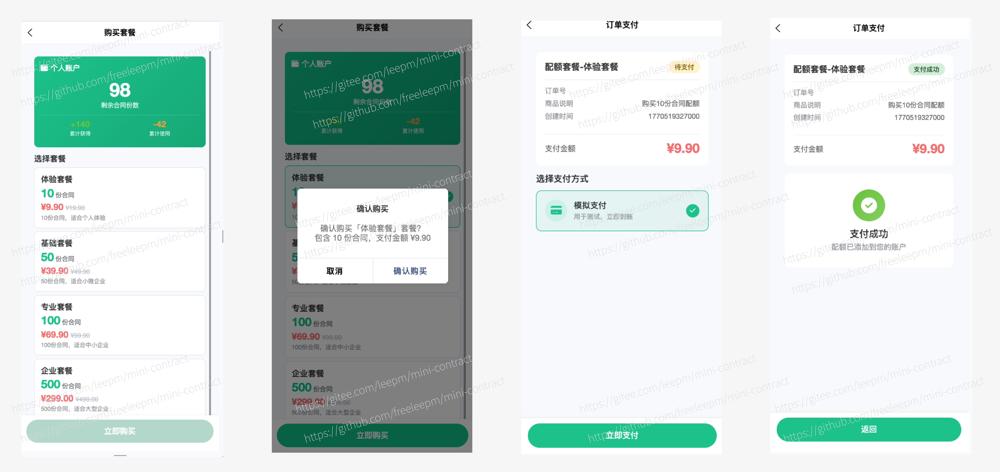

> 移动端合同配额购买：支持查看当前剩余合同份数，在线选择套餐并完成支付（微信支付/支付宝等），支付成功后配额即时到账，随时随地管理合同额度


#### 用户端（PC端）

> Web 用户端，可以在后台对自己的合同进行相应的签署和查看


> pc 端同样支持手机号+密码的方式与短信验证码的方式进行登录；


> 工作台支持查看基本的合同信息


> 查看所有的合同信息，支持在线签署和查看合同进度情况


> 创建合同时支持从历史签署记录中快速选择签署方，自动填充姓名、手机号、企业等信息，免去重复录入，提升创建效率


> 自行创建和管理个人印章和企业印章 


 
 

> 管理人员支持创建合同模版


> 合同模板支持可视化设计签名位置，管理员可在模板中为每位签署方预设固定的签名落章区域，签署时系统自动定位，签署方无需手动选择位置，确保签名位置精准统一


> 管理人员可以邀请企业员工


> 查看个人的基本信息


> 合同验真功能：上传已签署的 PDF 合同文件，系统自动验证文件完整性、数字签名有效性和签署证书状态。若合同未包含数字签名或签名无效，系统将给出明确的异常提示；若签名真实有效且文件未被篡改，则显示「验证通过」并展示签署方信息和签署时间，确保合同的真实性和法律效力可追溯


> 合同配额管理：支持在线购买合同份数，提供从个人体验到大型企业的多档套餐选择。支持微信支付、支付宝等主流支付渠道，也支持管理员手动分配配额，满足不同规模的商业化运营需求


### 最近更新

##### V 3.4.0（2026-04-05）

- [x] 【新增】合同详情：发起人可在「签署中 / 表单填写中」为待办参与方生成并复制签署链接（仅一名待办时一键复制，多名时可选择后再复制）
- [x] 【新增】合同 API：签署链接生成等相关接口封装（如 `generateSignLink`）
- [x] 【优化】请求层：统一登录过期清理与跳转；针对「需登录后方可查看」、签署方身份与当前账号不匹配等业务错误码，提供明确文案与「切换账号 / 返回」引导
- [x] 【修复】个人印章列表在状态筛选下的分页与「数量上限」统计（避免筛选后 total 变小导致上限校验偏差）
- [x] 【优化】个人中心印章页：与个人章 / 企业章入口拆分，列表与触底加载逻辑简化，减少误切换与重复请求
- [x] 【优化】实名认证（个人 / 企业）、KYC 引导弹窗、帮助中心、首页与企业相关入口的交互与提示一致性

##### V 3.3.0

- [x] 【新增】合同验真功能，支持验证已签署 PDF 的文件完整性、数字签名和签署证书
- [x] 【新增】合同配额管理，支持在线购买合同份数（微信支付/支付宝/手动分配）
- [x] 【新增】创建合同时支持从历史记录快速选择签署方
- [x] 【新增】合同模板支持可视化设计签名位置
- [x] 【新增】「快捷签署」与「安全签署」双签署模式
- [x] 【优化】产品名称集中配置管理，支持一键修改全局品牌信息

##### V 3.2.0 

- [x] 【新增】Word转PDF发起合同
- [x] 【新增】支持安全确认签署（意愿签署：短信、邮箱、登录密码）
- [x] 【新增】个人实名认证支持 OCR 识别
- [x] 【新增】支持设置签名位置
- [x] 【优化】优化整体用户体验和移动端相应的提示
- [x] 【修复】其它 issues 提出的 bug 问题；


##### V 3.1.0 

- [x] 【新增】微信授权、公众号授权登录
- [x] 【新增】创建合同时支持提前预设印章落章位置
- [x] 【新增】支持从历史记录里面选择签署人信息
- [x] 【修复】修复小程序端兼容性问题；
- [x] 【修复】pdf 加载慢的性能问题；
- [x] 【修复】其它 issues 提出的 bug 问题；


##### V 3.0 Pro 版本

- [x] 【新增】全新风格的页面设计
- [x] 【新增】全新技术架构
- [x] 【新增】天眼审查（智能合同审核）
- [x] 【新增】AI 起草（AIGC 合同生成）


### 技术文档

* 在线演示：

   https://m-sign.leepm.com (移动端) ，https://pc-sign.leepm.com (PC 端)

* 官方网站：

  https://s.leepm.com


### Star走势

[](https://star-history.com/#freeleepm/mini-contract&Date)


### 交流合作

如果你有任何对 Mini Contract Pro 产品上的想法、意见或建议，或商务上的合作需求，请扫码添加 Mini Contract Pro 项目团队进一步沟通：


## 产品认可

> 从产品对外开源之后，得到了特别多朋友们的关注和认可最终我们也达成了一些深度的合作，目前我们已经合作超过300+以上的合作伙伴，这当中有“企业”的朋友也有一些“个人独立开发者”


## 给个鼓励

如果觉得还不错，请 Watching，Starred，Fork 吧 ☺
